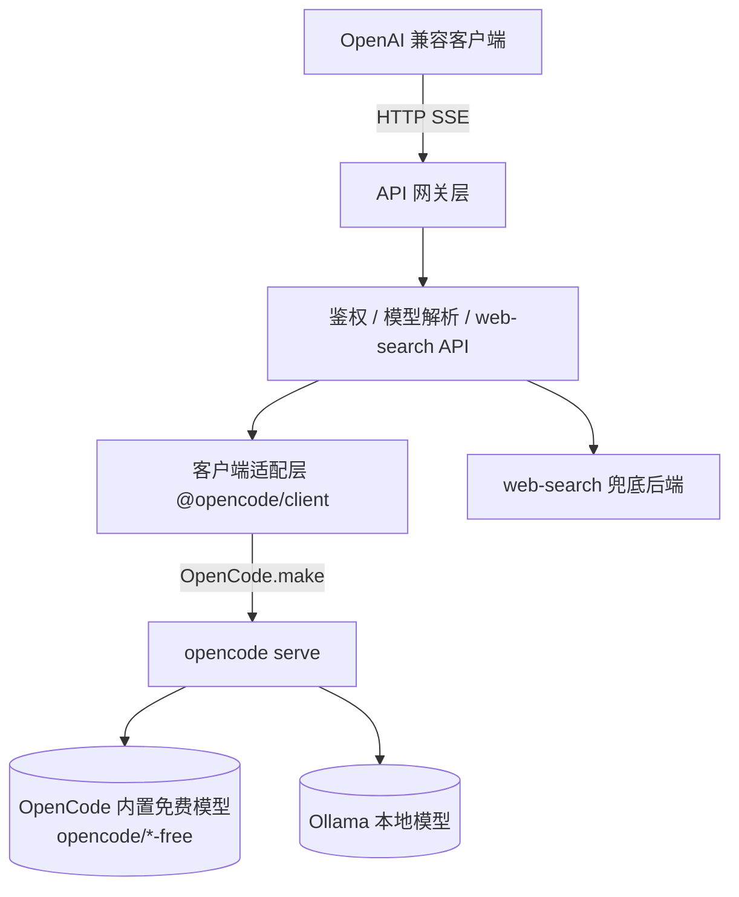

# OpenCode API Gateway

> 把本地 [OpenCode](https://opencode.ai)（2.x）运行时包装成 OpenAI 兼容推理网关：内置免费模型、Ollama 本地模型、独立 web-search API 一站式对外暴露。

[](./LICENSE)
[](https://nodejs.org)

**本项目基于 [TiaraBasori/OpenCode2API](https://github.com/TiaraBasori/OpenCode2API) 开发**，沿用了其「启动 `opencode serve` 后端 + 通过客户端与后端通信 + 暴露 OpenAI 兼容端点」的核心架构，并在模型选择、Ollama 接入、工具能力上做了差异化改造（详见下方「与原项目的关系」）。

---

## ✨ 功能特性

- **OpenAI 兼容**：`/v1/models`、`/v1/chat/completions`、`/v1/responses`，完整 SSE 流式输出；另兼容 Anthropic `/v1/messages`（可接 Claude SDK）。
- **模型别名查询**：`GET /v1/aliases` 返回 `models.aliases` / `ollama.aliases` 声明的短名映射，便于客户端发现可用别名。
- **`auto` 模型模式**：请求 `model: "auto"`，网关按 `models.allow` 白名单正则从内置模型池中**随机**选一款推理——专门应对「免费模型名称不固定、部分模型国内不可用」的问题。
- **Ollama 自定义模型**：可在配置中声明 Ollama 服务里的本地模型，对外以 `ollama/<id>` 暴露，零成本、可离线推理。
- **独立 web-search API**：输入**关键词**，优先走 OpenCode 2.x **服务端 websearch**（失败自动回退兜底搜索后端），抓取匹配网页、返回**段落文字**；仅 `query` 必填，`model` 可省略或使用别名，兜底后端默认免 key 的 DuckDuckGo（另支持 Bing）。
- **可选 API KEY 鉴权**：通过请求头 `Authorization: Bearer <key>` 做安全认证，可一键开关；接受的 key 默认从 `config/.keys` 读取（**一行一个**，可分发多条、单独吊销）。
- **Swagger / OpenAPI 文档**：`/docs` 交互式调试，`/docs/json` 输出 OpenAPI 3.1；规范由路由 schema（zod 生成 JSON Schema）自动汇总，随实现同步。

---

## 🏗️ 架构概览



- **进程/服务层**：拉起并管理 `opencode serve` 子进程（或连接已有实例），含健康检查。
- **客户端适配层**：封装 `@opencode/client`，统一注入凭据与超时控制；**client 版本必须与 `@opencode/cli` 同版本**。
- **模型解析层**：`auto` 白名单随机 / Ollama 映射 / 显式透传。
- **web-search 模块**：独立 API，服务端 websearch 优先 + 兜底搜索后端。

---

## 🚀 快速开始

### 前置条件

1. **Node.js ≥ 20.19**（见 `package.json` 的 `engines`；同时是 ESLint 10 的下限）。
2. 安装 OpenCode CLI，版本必须与 `@opencode/client` 一致（当前 **2.2.0**，两者都在构建期固定）：
   ```bash
   npm install -g @opencode/cli@2.2.0
   ```
3. （使用 Ollama）本地已运行 `ollama serve`，并已 `ollama pull` 所需模型。

> 2.x 的内置免费模型（`opencode/*-free`）**免登录**、cost=0，无需 `/connect`。

### 方式一：Node.js（本地开发）

```bash
git clone <your-fork-url> opencode-api-gateway
cd opencode-api-gateway
npm install
cp .env.example .env                # 部署相关 / 敏感项（config/config.yaml 已随仓库提供，无需复制）
cp config/.keys.example config/.keys # 可选：开启鉴权时要接受的 key，一行一个
npm start
curl http://127.0.0.1:10000/health
open http://127.0.0.1:10000/docs   # Swagger UI（无需额外配置）
```

> 使用 Ollama 时：`cp config/opencode.json.example config/opencode.json`，并以 `OPENCODE_CONFIG=./config/opencode.json npm start` 启动——OpenCode 只自动发现**项目根 / 全局**的 `opencode.json`，需用 `OPENCODE_CONFIG` 指向 `config/` 下的副本。

### 启动时的自动行为

`npm start` / `npm run dev` 默认加载项目根 `.env`，并按以下顺序启动：

1. **加载 `.env`**：解析 `KEY=VALUE`（支持注释、`export` 前缀与引号）；已存在的真实环境变量优先，容器内没有 `.env` 时静默跳过。
2. **探测 `OPENCODE_SERVER_PORT`**：端口已监听就直接用 `@opencode/client` 连接现有 `opencode serve`，不再重复拉起；端口空闲才按配置的端口与 `OPENCODE_SERVER_PASSWORD` 启动 `opencode serve` 子进程。设置了 `OPENCODE_SERVER_URL` 时只连接外部实例，不 spawn。
3. **输出可用模型**：启动后在终端按 provider 分组打印一次完整模型清单（内置 `opencode/*` + Ollama 等自定义 provider），并注明虚拟模型 `auto`。拉取失败不会阻塞网关启动，`/health` 会显示 `degraded`。
4. **每分钟自测**：每隔 60s 请求一次 `http://127.0.0.1:<PORT>/health`，日志记录延迟、后端版本与连续失败次数；`API_KEY_ENABLED=true` 时自动携带 Bearer key。

> 端口已被非 OpenCode 服务占用时，`/api/info` 探测会告警但仍按配置直连；此时 `/health` 会显示 `degraded`，请更换 `OPENCODE_SERVER_PORT` 或停掉占用进程。

### 推理用量日志

每次推理完成（chat / responses / messages 的流式与非流式，以及 `web_search` 的 `synthesize`）都会在 `LOG_LEVEL=info` 下输出一条结构化日志，便于统计 token 消耗：

```json
{"level":30,"event":"usage","endpoint":"/v1/chat/completions","model":"opencode/glm-4.6-free","stream":true,
 "prompt_tokens":1234,"completion_tokens":56,"reasoning_tokens":12,
 "cache_read":1000,"cache_write":0,"cost":0,"duration_ms":3210,"msg":"inference usage"}
```

- `prompt_tokens = tokens.input + tokens.cache.read`（OpenCode 的 `input` 只含未命中缓存的新内容，缓存前缀在 `cache.read`）。
- `completion_tokens = tokens.output`，`reasoning_tokens`、`cache_read/write`、`cost` 原样取自后端返回。
- 只记录成功完成的推理；失败请求走常规 `error` 日志，不含用量。

### 方式二：Docker（推荐）

```bash
cp .env.example .env
cp config/opencode.json.example config/opencode.json   # 可选：接入 Ollama / 服务端检索后端；不需要则跳过
cp config/.keys.example config/.keys                   # 可选：开启鉴权时的 key 清单（./config 已整目录只读挂载）
docker compose up -d
curl http://127.0.0.1:10000/health
```

> `@opencode/cli` 与 `@opencode/client` 的版本在 **Dockerfile 构建期固定**（非环境变量）；`config/config.yaml` 与 `config/opencode.json` 都放在 `./config`，整个目录只读挂载到 `/app/config`（`OPENCODE_CONFIG_DIR` 指向它），改配置后重启容器即可，不必重建镜像。默认 Compose 不挂载宿主机项目目录，避免覆盖镜像内 `node_modules`。
> Compose 会把 `.env` 的部署项与 provider 密钥（`OLLAMA_API_KEY` / `TAVILY_API_KEY`）注入容器；`opencode serve` 是网关的子进程、继承其环境，所以 `opencode.json` 里的 `{env:VAR}` 能取到值。

---

## 💡 使用示例

> 下面的 `$API_KEY` 指**任意一条被接受的 key**：`config/.keys` 里的任何一行，或环境变量 `API_KEY` 的值。开启鉴权后取清单里第一条最省事：
> `API_KEY=$(grep -Ev '^\s*(#|$)' config/.keys | head -1)`

### 1. Chat Completions（auto 模式 + 鉴权）

```bash
curl -X POST http://127.0.0.1:10000/v1/chat/completions \
  -H "Authorization: Bearer $API_KEY" \
  -H "Content-Type: application/json" \
  -d '{
    "model": "auto",
    "messages": [{"role": "user", "content": "用一句话介绍你自己"}],
    "stream": true
  }'
```

### 2. 显式免费模型 / Ollama 模型

```bash
# 显式指定 OpenCode 内置免费模型（*-free 系列，免登录）
curl ... -d '{"model":"opencode/flint-40b-free","messages":[{"role":"user","content":"hi"}],"stream":false}'

# Ollama 本地模型（需在 config/opencode.json 的 provider.ollama.models 声明）
curl ... -d '{"model":"ollama/qwen3:4b","messages":[{"role":"user","content":"hi"}],"stream":false}'
```

### 3. Responses API（流式 + 推理）

```bash
curl -N -X POST http://127.0.0.1:10000/v1/responses \
  -H "Authorization: Bearer $API_KEY" \
  -H "Content-Type: application/json" \
  -d '{"model":"auto","input":"用一句话打招呼","stream":true}'
```

### 4. web-search 独立 API

`web-search` 是**独立 API**（不内嵌为工具、不追求工具调用通用性）：输入关键词，优先走 OpenCode 2.x 服务端 websearch（服务端自选已配置后端），失败时回退兜底搜索后端；网关抓取匹配网页、返回**段落文字**。**仅 `query` 必填**；`model` 可省略且支持别名（`models.aliases` / `ollama.aliases`），省略时依次取 `web_search.model`（若配置）→ 首个 `ollama-local/*` → `models.auto.fallback`；显式指定时不可为 `auto` / `ollama/...`。该模型仅 `synthesize=true` 时驱动答案综合。

```bash
curl -X POST http://127.0.0.1:10000/v1/web_search \
  -H "Authorization: Bearer $API_KEY" \
  -H "Content-Type: application/json" \
  -d '{
    "model": "opencode/flint-40b-free",
    "query": "OpenCode 项目 最近更新",
    "top_k": 5,
    "locale": "zh-CN",
    "synthesize": false,
    "include_sources": true
  }'
```

响应核心字段：`text`（匹配网页的段落文字，可直接喂给模型）、`results[]`（逐页标题/URL/段落，可选）、`answer`（`synthesize=true` 时由指定内置模型综合生成）、`engine`（实际检索后端：`opencode-websearch` 或兜底后端名）、`truncated`。详见 [API 设计文档](./docs/api.md) §8。

### 5. 模型别名列表

```bash
curl http://127.0.0.1:10000/v1/aliases
```

```json
{
  "object": "list",
  "data": [
    { "alias": "flint", "model": "opencode/flint-40b-free", "source": "models.aliases" },
    { "alias": "qwen3.5", "model": "ollama-local/qwen3.5:9b", "source": "ollama.aliases" }
  ]
}
```

仅返回 `config/config.yaml` 中声明的别名（不校验目标模型当前是否可用），按 `alias` 升序；不受 `models.allow` 影响。详见 [API 设计文档](./docs/api.md) §10。

## 🏷️ 模型命名规则

| 类型 | 形式 | 示例 | 规则 |
|:-----|:-----|:-----|:-----|
| 虚拟 | `auto` | `auto` | 仅在内置模型池按 `config/config.yaml` 的 `models.allow` 随机 |
| 内置 | `<provider>/<id>` | `opencode/flint-40b-free` | 由 OpenCode `model.list()` 决定，须存在且可用 |
| Ollama | `ollama/<ollama-model-id>` | `ollama/qwen3:4b` | `<id>` 须与 `ollama list` 一致且在 `config/opencode.json` 的 `provider.ollama.models` 声明 |

- `models.allow` 同时是 `/v1/models` 的展示白名单：只有全名命中其中任一正则的模型才会列出（空列表表示不过滤）。
- `auto` 池**只含内置模型**，且只从命中 `models.allow` 的模型中选择（再剔除 `models.auto.exclude`），不含 Ollama 自定义。
- 可选 `config/config.yaml` 的 `ollama.aliases`（如 `qwen→ollama/qwen3:4b`）做短名映射。
- 完整解析优先级与校验正则见 [api.md §7](./docs/api.md)。

---

## ⚙️ 配置

配置按**职责分层**：版本在 Dockerfile 固定，敏感/部署项走环境变量，业务默认走 `config/config.yaml`，provider 与服务端检索后端声明走 `config/opencode.json`。

### 环境变量（部署相关 / 敏感）

| 变量 | 默认 | 说明 |
|:-----|:-----|:-----|
| `PORT` | `10000` | 网关对外端口 |
| `OPENCODE_SERVER_PORT` | `10001` | 后端端口（未设 `OPENCODE_SERVER_URL` 时生效） |
| `OPENCODE_SERVER_URL` | 空 | 外部实例地址；设置后不拉起子进程，直接连接（复用已登录态） |
| `OPENCODE_SERVER_PASSWORD` | 空 | OpenCode server HTTP Basic 密码（必填，保护后端） |
| `API_KEY_ENABLED` | `false` | 是否开启对外 API KEY 鉴权 |
| `API_KEYS_FILE` | `./config/.keys` | **对外 key 清单文件，一行一个**（详见下一节） |
| `API_KEY` | 空 | 单个 key，追加进 `config/.keys` 的集合并排在最前 |
| `SEARCH_API_KEY` | 空 | 仅付费搜索后端需要；默认免费后端无需 |
| `OLLAMA_API_KEY` | 空 | 网关不读，透传给 `opencode serve`；`config/opencode.json` 以 `{env:OLLAMA_API_KEY}` 引用 |
| `TAVILY_API_KEY` | 空 | 网关不读，透传给 `opencode serve`；仅在固定某个检索后端时需要 |
| `OPENCODE_CONFIG_CONTENT` | 镜像预设 `{"websearch":{"provider":"random"}}` | 网关不读，透传给 `opencode serve` 的内联配置；设置它会整体替换镜像预设 |
| `CONFIG_PATH` | `./config/config.yaml` | 配置文件路径 |
| `LOG_LEVEL` | `info` | 网关日志级别（fatal/error/warn/info/debug/trace/silent） |

### config/config.yaml（业务默认值，直接入库、随镜像打包）

> 不含敏感信息，无需 example 模板；密钥只走环境变量（见下表）。

| 键 | 默认 | 说明 |
|:---|:-----|:-----|
| `models.allow` | `[]` | 模型白名单：全名命中任一正则才会出现在 `/v1/models`，auto 也只从中选（空列表不过滤） |
| `models.auto.exclude` | `[]` | auto 选池的排除名单（国内不可用等） |
| `models.auto.fallback` | 空 | auto 池为空时兜底模型 |
| `models.aliases` | `{}` | 内置模型短名映射（可选） |
| `ollama.aliases` | `{}` | `短名 → ollama/<id>` 映射（可选） |
| `web_search.model` | 空 | 可选显式默认模型（支持别名）；留空自动取首个 `ollama-local/*`，无则 `models.auto.fallback` |
| `web_search.synthesize_default` | `false` | 默认是否综合答案 |
| `search.provider` | `duckduckgo` | 兜底搜索后端：`duckduckgo` / `bing` 免费无需 key；`brave` 需 `SEARCH_API_KEY`；`custom` 自建 |
| `search.base_url` | 空 | `custom` 后端地址（可选） |
| `search.headers` | `{}` | `custom` 后端请求头（可选） |
| `search.top_k` | `5` | 默认结果条数（API 可覆盖） |
| `search.max_chars_per_page` | `4000` | 默认单页截断（API 可覆盖） |
| `session.ttl_min` | `30` | 会话清理 TTL |

> `top_k` / `max_chars_per_page` 已从环境变量移除，改为 `config/config.yaml` 默认值 + 请求参数覆盖。

### config/.keys（对外 API KEY 清单，可选）

> 开启 `API_KEY_ENABLED=true` 后，网关接受的 key **默认从这个文件读取，一行一个**。文件里就是**明文 key**，原样比对：不加解密、不哈希、不做 `{env:VAR}` 插值。模板 `config/.keys.example` 入库，实际文件 `config/.keys` 不入库、不进镜像层。

```
# 一行一个 key，空行与 # 开头的行忽略，自动去重
sk-0f3a...
sk-9c17...
```

- 路径由 `API_KEYS_FILE` 覆盖（默认 `./config/.keys`；容器工作目录是 `/app`，同一默认值即 `/app/config/.keys`，落在已有的 `./config` 只读挂载上，**不需要额外挂卷**）。
  `.env` 里的值不会透传进容器——宿主机路径（如 `D:\...\config\.keys`）在容器里无意义，compose 故意不转发它；要改容器内路径请直接写进 `docker-compose.yml` 的 `environment`。
- 环境变量 `API_KEY` 仍然有效，**追加进同一集合并排在最前**，与文件里的 key 重复时只保留一份。
- 多 key 只是「任意一条匹配即放行」，用于**分发凭据与单条吊销**，不含配额、计费、按 key 路由等语义。
- 改完文件要重启进程才生效（启动时读一次）。
- 每次启动都打一条 key 清单状态日志（只有路径与条数，**绝不含 key 值**）：文件在且有 key → `info`；**文件没找到且 `API_KEY` 也没配 → `error`**（此时所有请求 `401`，最容易误判成网关坏了）；文件没找到但 `API_KEY` 有值 → `warn`（只认环境变量那条）；鉴权关闭且无文件 → `debug`。
- 边界情形：文件在但一行可用 key 都没有，等同于「没读到 key」→ `error`；文件读不了（权限等）→ 启动失败，不会退化成「无鉴权放行」。
- 鉴权挂在 `onRequest`，**先于请求体校验**：没带 key 的调用方只会拿到 `401`，看不到 `400` 的 schema 提示。
- key 明文只出现在内存与比较运算里：**不进日志、不进错误响应、不进镜像层、不入库**。

### config/opencode.json（provider 与服务端检索后端，可选）

> 模板为 `config/opencode.json.example`，复制后使用（实际文件含本机地址，不入库，也不进镜像层）。
> 2.x 格式为 `providers.<id>.package/settings/models`，完整字段以模板为准。
> Docker 中 `./config` 挂载到 `/app/config`；本地直跑用 `OPENCODE_CONFIG=./config/opencode.json` 指向它。

> `OLLAMA_BASE_URL` / `OLLAMA_MODELS` 环境变量已移除，统一由该文件管理。
> 文件里的密钥一律写成 `{env:OLLAMA_API_KEY}` 插值，明文只存在于 `.env`（已 gitignore）。

**服务端 websearch 主路径（`engine=opencode-websearch`）只需要一句 provider 声明，不需要密钥**：

```json
{ "websearch": { "provider": "random" } }
```

未声明时 `websearch.query()` 直接报 `Web search provider is required`。本机之所以「什么都没配也能用」，是因为交互式跑过 opencode 后，这条声明被持久化进了它自己的状态库（`~/.local/share/opencode/opencode.db` 的 `kv` 表：`websearch:provider = "random"`）；容器是全新的 OpenCode home，没有这条记录，所以要么写在 `opencode.json`，要么走环境变量 `OPENCODE_CONFIG_CONTENT`——**镜像已预设为 `{"websearch":{"provider":"random"}}`，开箱即用**。
要固定某个后端（`exa` / `firecrawl` / `parallel` / `tavily` / `tinyfish`）才需要写 `"provider": "tavily"` 并提供同名 `*_API_KEY`（compose 已透传 `TAVILY_API_KEY`，其余同名变量自行加进 `environment`）。
两者都不满足也不影响可用性——网关记一条 warn 后回退到免 key 的兜底后端（`search.provider`）。

### 镜像内环境变量默认值（Dockerfile 预设）

`.env` 里的部署项在镜像里就有默认值（与 `src/config.mjs` 一致），`docker run` 不带任何参数也能起来；运行期用 compose / `--env-file` / `-e` 覆盖即可。

| 变量 | 镜像默认值 | 说明 |
|:-----|:-----------|:-----|
| `PORT` | `10000` | 网关对外端口 |
| `OPENCODE_SERVER_PORT` | `10001` | 容器内 `opencode serve` 端口 |
| `OPENCODE_SERVER_URL` | 空 | 留空 = 容器内自拉起；设置后只连外部实例 |
| `LOG_LEVEL` | `info` | 网关日志级别 |
| `CONFIG_PATH` | `/app/config/config.yaml` | 容器内配置路径 |
| `OPENCODE_SERVER_PASSWORD` / `API_KEY` / `SEARCH_API_KEY` / `OLLAMA_API_KEY` / `TAVILY_API_KEY` | 镜像内不存在 | **密钥只走运行期注入**（compose / `--env-file` / `-e`），不作为 `ARG` 也不作为 `ENV`，绝不进镜像层与 `docker history` |
| `config/.keys` | 镜像内不存在 | key 清单同样只由运行期的 `./config` 只读挂载提供（`.dockerignore` 排除），镜像里只有模板 `config/.keys.example` |
| `API_KEY_ENABLED` / `API_KEYS_FILE` | 镜像内不设 | 默认值在 `src/config.mjs`（`false` / `./config/.keys`，工作目录 `/app` 下即 `/app/config/.keys`）；镜像里不写这两个 `ENV`，只因 BuildKit 会把**名字**含 `API_KEY` 的变量当密钥告警。compose 也**不转发** `API_KEYS_FILE`：`.env` 里写的是宿主机路径（如 `D:\...\config\.keys`），进了容器只会指向一个不存在的文件、把 key 清单清空 |

### 容器内 OpenCode 精简变量（Dockerfile 预设）

镜像已预设以下变量，一般无需修改；如需覆盖，在 `docker-compose.yml` 的 `environment` 中显式声明即可。

| 变量 | 值 | 作用 |
|:-----|:---|:-----|
| `OPENCODE_CONFIG_DIR` | `/app/config` | 配置目录（唯一挂载点，含 config.yaml 与 opencode.json） |
| `OPENCODE_DISABLE_PROJECT_CONFIG` | `true` | 不读项目级 `opencode.json` / `AGENTS.md` |
| `OPENCODE_DISABLE_CLAUDE_CODE` | `true` | 不读 `CLAUDE.md` |
| `OPENCODE_DISABLE_CLAUDE_CODE_SKILLS` | `true` | 不加载 Claude 风格技能目录 |
| `OPENCODE_DISABLE_AUTOUPDATE` | `true` | 关闭自动更新检查 |
| `OPENCODE_DISABLE_FILEWATCHER` | `true` | 关闭文件监听 |
| `OPENCODE_CONFIG_CONTENT` | `{"websearch":{"provider":"random"}}` | 内联 OpenCode 配置：补上服务端 websearch 的 provider 声明（免密钥，详见上一节） |

> 变量名逐个对 2.2.0 二进制核过：1.x 的 `OPENCODE_DISABLE_DEFAULT_PLUGINS` 与 `OPENCODE_DISABLE_LSP_DOWNLOAD` 在 2.x 已不被识别，因此不再设置。

**推荐生产配置（.env）：**

```env
OPENCODE_SERVER_PASSWORD=your-password
API_KEY_ENABLED=true
# 对外 key 清单：config/.keys（一行一个）。API_KEY 只用于临时追加一个 key，可留空
API_KEY=
```

**推荐生产配置（config/config.yaml）：**

```yaml
models:
  allow: ["^opencode/.*-free$"]
  auto:
    exclude: ["opencode/unstable-model-free"]
    fallback: "opencode/flint-40b-free"
  aliases: { flint: "opencode/flint-40b-free" }
ollama:
  aliases: { qwen: "ollama/qwen3:4b" }
web_search:
  model: ""                 # 留空：首个 ollama-local/* → models.auto.fallback
search:
  provider: "duckduckgo"    # 免费免 key；可选 bing（免费）/ brave（需 key）/ custom（自建）
  top_k: 5
  max_chars_per_page: 4000
```

---

## 🧪 开发与规范

源码为**纯 JavaScript ESM（`.mjs`）**，无 TypeScript、无构建步骤。规范正文见 [AGENTS.md](./AGENTS.md)，其中「JS 代码规范」里可由 AST 判定的部分由 `config/eslint.config.mjs` 强制执行（`npm run lint` 内通过 `--config` 指定）：

```bash
npm run lint      # 提交前必跑，必须零 error（warning 基线为 0）
npm run lint:fix  # 自动修缩进 / 引号 / 分号
npm test          # node --test，跑 tests/**/*.test.mjs
npm run check     # lint + test，即交付门槛
```

- 相对 import **必须带 `.mjs` 扩展名**（Node ESM 不会自动补全）。
- 依赖方向：`src/api` / `src/tools` → `src/core`；`src/core` 不得 import 上层（lint 已强制）。
- 新增/修改端点时，在路由 `schema` 中补 `tags` / `summary` / `body` / `response`；请求体 schema 用 `toJsonSchema(zodSchema)` 生成，`/docs` 会自动更新。
- 不允许通过改 `ignores`、整文件 `eslint-disable`、或把规则降级来绕过检查。

---

## 📁 目录结构（规划）

```
opencode-api-gateway/
├── src/
│   ├── core/            # 进程管理、客户端适配、模型命名/解析、/health 自测
│   ├── api/             # 路由：health / models / aliases / chat / responses / messages / web_search
│   │                    # openapi.mjs：Swagger / OpenAPI 3.1 文档（/docs）
│   │                    # auth / sse / inference / protocol：鉴权、SSE、推理流程与协议转换
│   ├── tools/           # web-search 独立 API 实现（服务端 websearch 优先 + 兜底）
│   ├── config.mjs       # 配置层（zod 校验 + .env 加载）
│   ├── startup-report.mjs # 启动时的终端模型清单
│   └── index.mjs        # 入口
├── tests/               # node:test 用例（*.test.mjs）
├── scripts/             # 运维 / 自检脚本
├── docs/
│   ├── design.md        # 项目设计文档
│   └── api.md           # API 详细设计
├── config/
│   ├── config.yaml            # 业务默认值（模型/搜索/会话），直接入库
│   ├── opencode.json.example  # provider / 服务端检索后端配置模板（复制为 config/opencode.json）
│   ├── .keys.example          # 对外 API KEY 清单模板（复制为 config/.keys，一行一个；实际文件不入库）
│   └── eslint.config.mjs      # ESLint flat config（npm run lint --config 指定）
├── AGENTS.md                 # 协作与 JS 代码规范（lint 门槛）
├── package.json              # 依赖与脚本（lint / test / start）
├── .env.example              # 环境变量（部署/敏感）
├── Dockerfile                # 构建期固定 @opencode/cli / @opencode/client 版本
├── docker-compose.yml
└── README.md
```

---

## 🔗 与原项目的关系

本项目 **fork / 衍生自 [TiaraBasori/OpenCode2API](https://github.com/TiaraBasori/OpenCode2API)**，沿用其「`opencode serve` + SDK + OpenAI 兼容网关」的核心架构与部分工程实现。

相对原项目的**差异化改造**：

| 维度 | 原 OpenCode2API | 本项目 |
|:-----|:----------------|:-------|
| 模型选择 | 别名解析 + allowlist | 新增 **`auto` 白名单随机模式** + 国内可用性过滤 |
| 外部工具 | `web_fetch`（按 URL 抓取） | **独立 `web_search` API**（关键词 → 段落文字，需指定内置模型） |
| 模型命名 | 别名解析 | **内置 `<provider>/<id>` + Ollama `ollama/<id>` 统一规则** |
| Ollama | 依赖 OpenCode 自带 provider | 在 `config/opencode.json` 声明，随镜像打包；网关经 `model.list()` 发现 |
| 定位 | 通用网关 + 面板/指标 | 聚焦 chat/responses + 国内环境友好 |

如本项目代码对你有帮助，请同时参考并遵守原项目的 MIT 许可证与致谢。

---

## 📚 文档

- [项目设计文档](./docs/design.md) —— 架构、流程、模块、风险与里程碑
- [API 设计文档](./docs/api.md) —— 全部端点字段、SSE 事件序、错误码与 web-search 设计
- [AGENTS.md](./AGENTS.md) —— 协作规范与 JS 代码规范（lint 门槛、配置分层、版本耦合）

---

## ⚠️ 注意事项

- **client 与 serve 版本必须匹配**：`@opencode/client` 由 server OpenAPI 规范生成，请在 **Dockerfile 构建期**固定 `@opencode/cli` 与 `@opencode/client` 同版本（不再用环境变量）；`package.json` 已锁定 `2.2.0`，升级需两边同步并更新 lock。
- **内置免费模型免登录**：2.x 的 `opencode/*-free` 模型直接可用（cost=0），无需 `/connect`；Ollama 等自定义 provider 仍需在 `config/opencode.json` 配置。
- **免费额度耗尽**：OpenCode 返回 `provider.free-limit` 时，推理接口统一返回 **429 `quota_exceeded`**（其他模型错误为 502）；此时可切换 `ollama-local/*` 继续推理，`/v1/web_search` 默认的纯检索路径不受影响。
- **web-search 独立 API**：仅 `query` 必填；`model` 可省略（`web_search.model` → 首个 `ollama-local/*` → `models.auto.fallback`）或用别名，显式指定时不可 `auto`/`ollama`。服务端 websearch 需在 OpenCode 侧**声明** provider（镜像已预设 `random`，免密钥；本机跑过交互式 opencode 也自带这条状态），未声明时自动回退兜底后端；要固定 exa/tavily 等再补对应 `*_API_KEY`（是否收费由该后端决定）。网关兜底 `search.provider` 中 **`duckduckgo` / `bing` 免费且无需 key**（`duckduckgo` 国内不稳），`brave` 需 `SEARCH_API_KEY`，`custom` 为自建网关。
- **Swagger 文档**：`/docs` 与 `/docs/json` 在开启 `API_KEY` 后仍公开（浏览器打开 UI 时无法自动附加 Authorization），仅暴露接口结构，不含任何密钥；`API_KEY_ENABLED=true` 时文档根带 `security`，页面右上出现 **Authorize**，填 `config/.keys` 里任意一行即可让「Try it out」带上 `Authorization: Bearer`（`/v1/messages` 也可填 `x-api-key`）。开关改变后要**重建**容器（`docker compose up -d --force-recreate`）才生效：文档在启动时生成，而 `docker restart` 不重读宿主机 `.env`。**重启后 `/docs` 页面必须刷新**：旧页面里那份文档没有 `security`，Authorize 弹窗看着填好了，请求却不会带 `Authorization`（Value 只填 key 本身，写 `Bearer sk-…` 或加引号都会 401）。排查只看一处——Execute 后展开的 curl：有 `-H 'Authorization: ...'` 说明头带上了，401 就是 key 值不对；没有这行说明当前标签页没持有凭据。`localhost` 与 `127.0.0.1` 是两个源，授权状态互不共享。新增端点时在路由 schema 上补 `tags` / `summary` / `body` / `response`，文档会自动更新。

---

## 📄 许可证

MIT —— 衍生自 [TiaraBasori/OpenCode2API](https://github.com/TiaraBasori/OpenCode2API)（MIT）。

## 🙏 致谢

- [TiaraBasori/OpenCode2API](https://github.com/TiaraBasori/OpenCode2API) —— 本项目的架构基础与工程参考
- [OpenCode](https://opencode.ai) —— 提供 `opencode serve` 与 `@opencode/client`
- OpenCode 社区的其他同类项目（opencode-to-openai、opencode-openai-proxy 等）
