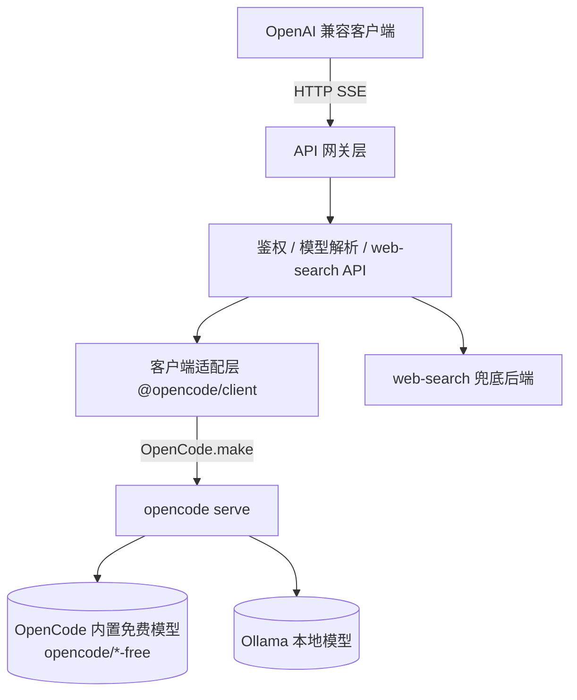

# OpenCode API Gateway

> 把本地 [OpenCode](https://opencode.ai)（2.x）运行时包装成 OpenAI 兼容推理网关：内置免费模型、Ollama 本地模型、独立 web-search API 一站式对外暴露。

[](./LICENSE)
[](https://nodejs.org)

**本项目基于 [TiaraBasori/OpenCode2API](https://github.com/TiaraBasori/OpenCode2API) 开发**，沿用了其「启动 `opencode serve` 后端 + 通过客户端与后端通信 + 暴露 OpenAI 兼容端点」的核心架构，并在模型选择、Ollama 接入、工具能力上做了差异化改造（详见下方「与原项目的关系」）。

---

## ✨ 功能特性

- **OpenAI 兼容**：`/v1/models`、`/v1/chat/completions`、`/v1/responses`，完整 SSE 流式输出；另兼容 Anthropic `/v1/messages`（可接 Claude SDK）。
- **`auto` 模型模式**：请求 `model: "auto"`，网关按配置**正则**从可用模型池中**随机**选一款推理——专门应对「免费模型名称不固定、部分模型国内不可用」的问题。
- **Ollama 自定义模型**：可在配置中声明 Ollama 服务里的本地模型，对外以 `ollama/<id>` 暴露，零成本、可离线推理。
- **独立 web-search API**：输入**关键词**，优先走 OpenCode 2.x **服务端 websearch**（失败自动回退兜底搜索后端），抓取匹配网页、返回**段落文字**；需指定内置模型。
- **可选 API KEY 鉴权**：通过请求头 `Authorization: Bearer <key>` 做安全认证，可一键开关。

---

## 🏗️ 架构概览



- **进程/服务层**：拉起并管理 `opencode serve` 子进程（或连接已有实例），含健康检查。
- **客户端适配层**：封装 `@opencode/client`，统一注入凭据与超时控制；**client 版本必须与 `@opencode/cli` 同版本**。
- **模型解析层**：`auto` 正则随机 / Ollama 映射 / 显式透传。
- **web-search 模块**：独立 API，服务端 websearch 优先 + 兜底搜索后端。

---

## 🚀 快速开始

### 前置条件

1. **Node.js ≥ 20.19**（见 `package.json` 的 `engines`；同时是 ESLint 10 的下限）。
2. 安装 OpenCode CLI，版本必须与 `@opencode/client` 一致（当前 **2.1.4**，两者都在构建期固定）：
   ```bash
   npm install -g @opencode/cli@2.1.4
   ```
3. （使用 Ollama）本地已运行 `ollama serve`，并已 `ollama pull` 所需模型。

> 2.x 的内置免费模型（`opencode/*-free`）**免登录**、cost=0，无需 `/connect`。

### 方式一：Node.js（本地开发）

```bash
git clone <your-fork-url> opencode-api-gateway
cd opencode-api-gateway
npm install
cp .env.example .env   # 部署相关 / 敏感项（config/config.yaml 已随仓库提供，无需复制）
npm start
curl http://127.0.0.1:10000/health
```

> 使用 Ollama 时：`cp config/opencode.json.example config/opencode.json`，并以 `OPENCODE_CONFIG=./config/opencode.json npm start` 启动——OpenCode 只自动发现**项目根 / 全局**的 `opencode.json`，需用 `OPENCODE_CONFIG` 指向 `config/` 下的副本。

### 启动时的自动行为

`npm start` / `npm run dev` 默认加载项目根 `.env`，并按以下顺序启动：

1. **加载 `.env`**：解析 `KEY=VALUE`（支持注释、`export` 前缀与引号）；已存在的真实环境变量优先，容器内没有 `.env` 时静默跳过。
2. **探测 `OPENCODE_SERVER_PORT`**：端口已监听就直接用 `@opencode/client` 连接现有 `opencode serve`，不再重复拉起；端口空闲才按配置的端口与 `OPENCODE_SERVER_PASSWORD` 启动 `opencode serve` 子进程。设置了 `OPENCODE_SERVER_URL` 时只连接外部实例，不 spawn。
3. **输出可用模型**：启动后在终端按 provider 分组打印一次完整模型清单（内置 `opencode/*` + Ollama 等自定义 provider），并注明虚拟模型 `auto`。拉取失败不会阻塞网关启动，`/health` 会显示 `degraded`。
4. **每分钟自测**：每隔 60s 请求一次 `http://127.0.0.1:<PORT>/health`，日志记录延迟、后端版本与连续失败次数；`API_KEY_ENABLED=true` 时自动携带 Bearer key。

> 端口已被非 OpenCode 服务占用时，`/api/info` 探测会告警但仍按配置直连；此时 `/health` 会显示 `degraded`，请更换 `OPENCODE_SERVER_PORT` 或停掉占用进程。

### 方式二：Docker（推荐）

```bash
cp .env.example .env
docker compose up -d
curl http://127.0.0.1:10000/health
```

> `@opencode/cli` 与 `@opencode/client` 的版本在 **Dockerfile 构建期固定**（非环境变量）；`config/config.yaml` 与 `config/opencode.json` 一并打包进镜像。默认 Compose 不挂载宿主机项目目录，避免覆盖镜像内 `node_modules`。

---

## 💡 使用示例

### 1. Chat Completions（auto 模式 + 鉴权）

```bash
curl -X POST http://127.0.0.1:10000/v1/chat/completions \
  -H "Authorization: Bearer $API_KEY" \
  -H "Content-Type: application/json" \
  -d '{
    "model": "auto",
    "messages": [{"role": "user", "content": "用一句话介绍你自己"}],
    "stream": true
  }'
```

### 2. 显式免费模型 / Ollama 模型

```bash
# 显式指定 OpenCode 内置免费模型（*-free 系列，免登录）
curl ... -d '{"model":"opencode/flint-40b-free","messages":[{"role":"user","content":"hi"}],"stream":false}'

# Ollama 本地模型（需在 config/opencode.json 的 provider.ollama.models 声明）
curl ... -d '{"model":"ollama/qwen3:4b","messages":[{"role":"user","content":"hi"}],"stream":false}'
```

### 3. Responses API（流式 + 推理）

```bash
curl -N -X POST http://127.0.0.1:10000/v1/responses \
  -H "Authorization: Bearer $API_KEY" \
  -H "Content-Type: application/json" \
  -d '{"model":"auto","input":"用一句话打招呼","stream":true}'
```

### 4. web-search 独立 API

`web-search` 是**独立 API**（不内嵌为工具、不追求工具调用通用性）：输入关键词，优先走 OpenCode 2.x 服务端 websearch（服务端自选已配置后端），失败时回退兜底搜索后端；网关抓取匹配网页、返回**段落文字**。**必须指定一款内置模型**（`model` 为 `<provider>/<id>`，不可为 `auto` / `ollama/...`），也可用 `config/config.yaml` 的 `web_search.model` 设默认（该模型仅 `synthesize=true` 时驱动答案综合）。

```bash
curl -X POST http://127.0.0.1:10000/v1/web_search \
  -H "Authorization: Bearer $API_KEY" \
  -H "Content-Type: application/json" \
  -d '{
    "model": "opencode/flint-40b-free",
    "query": "OpenCode 项目 最近更新",
    "top_k": 5,
    "locale": "zh-CN",
    "synthesize": false,
    "include_sources": true
  }'
```

响应核心字段：`text`（匹配网页的段落文字，可直接喂给模型）、`results[]`（逐页标题/URL/段落，可选）、`answer`（`synthesize=true` 时由指定内置模型综合生成）、`engine`（实际检索后端：`opencode-websearch` 或兜底后端名）、`truncated`。详见 [API 设计文档](./docs/api.md) §8。

## 🏷️ 模型命名规则

| 类型 | 形式 | 示例 | 规则 |
|:-----|:-----|:-----|:-----|
| 虚拟 | `auto` | `auto` | 仅在内置模型池按 `config/config.yaml` 的 `models.auto.regex` 随机 |
| 内置 | `<provider>/<id>` | `opencode/flint-40b-free` | 由 OpenCode `model.list()` 决定，须存在且可用 |
| Ollama | `ollama/<ollama-model-id>` | `ollama/qwen3:4b` | `<id>` 须与 `ollama list` 一致且在 `config/opencode.json` 的 `provider.ollama.models` 声明 |

- `auto` 池**只含内置模型**，不含 Ollama 自定义。
- 可选 `config/config.yaml` 的 `ollama.aliases`（如 `qwen→ollama/qwen3:4b`）做短名映射。
- 完整解析优先级与校验正则见 [api.md §7](./docs/api.md)。

---

## ⚙️ 配置

配置按**职责分层**：版本在 Dockerfile 固定，敏感/部署项走环境变量，业务默认走 `config/config.yaml`，Ollama provider 走 `config/opencode.json`。

### 环境变量（部署相关 / 敏感）

| 变量 | 默认 | 说明 |
|:-----|:-----|:-----|
| `PORT` | `10000` | 网关对外端口 |
| `OPENCODE_SERVER_PORT` | `10001` | 后端端口（未设 `OPENCODE_SERVER_URL` 时生效） |
| `OPENCODE_SERVER_URL` | 空 | 外部实例地址；设置后不拉起子进程，直接连接（复用已登录态） |
| `OPENCODE_SERVER_PASSWORD` | 空 | OpenCode server HTTP Basic 密码（必填，保护后端） |
| `API_KEY_ENABLED` | `false` | 是否开启对外 API KEY 鉴权 |
| `API_KEY` | 空 | 单 key |
| `SEARCH_API_KEY` | 空 | 仅付费搜索后端需要；默认免费后端无需 |
| `CONFIG_PATH` | `./config/config.yaml` | 配置文件路径 |
| `LOG_LEVEL` | `info` | 网关日志级别（fatal/error/warn/info/debug/trace/silent） |

### config/config.yaml（业务默认值，直接入库、随镜像打包）

> 不含敏感信息，无需 example 模板；密钥只走环境变量（见下表）。

| 键 | 默认 | 说明 |
|:---|:-----|:-----|
| `models.auto.regex` | `[]` | auto 正则（仅内置模型） |
| `models.auto.exclude` | `[]` | 排除名单（国内不可用等） |
| `models.auto.fallback` | 空 | 池为空时兜底模型 |
| `models.aliases` | `{}` | 内置模型短名映射（可选） |
| `ollama.aliases` | `{}` | `短名 → ollama/<id>` 映射（可选） |
| `web_search.model` | 空 | web-search 默认内置模型 |
| `web_search.synthesize_default` | `false` | 默认是否综合答案 |
| `search.provider` | `duckduckgo` | 兜底搜索后端（默认免费） |
| `search.base_url` | 空 | `custom` 后端地址（可选） |
| `search.headers` | `{}` | `custom` 后端请求头（可选） |
| `search.top_k` | `5` | 默认结果条数（API 可覆盖） |
| `search.max_chars_per_page` | `4000` | 默认单页截断（API 可覆盖） |
| `session.ttl_min` | `30` | 会话清理 TTL |

> `top_k` / `max_chars_per_page` 已从环境变量移除，改为 `config/config.yaml` 默认值 + 请求参数覆盖。

### config/opencode.json（Ollama provider，可选）

> 模板为 `config/opencode.json.example`，复制后使用（实际文件含本机地址，不入库）。

```json
{
  "$schema": "https://opencode.ai/config.json",
  "provider": {
    "ollama": {
      "npm": "@ai-sdk/openai-compatible",
      "name": "Ollama (local)",
      "options": { "baseURL": "http://host.docker.internal:11434/v1" },
      "models": { "qwen3:4b": { "name": "Qwen3 4B (local)" } }
    }
  }
}
```

> `OLLAMA_BASE_URL` / `OLLAMA_MODELS` 环境变量已移除，统一由该文件管理。

**推荐生产配置（.env）：**

```env
OPENCODE_SERVER_PASSWORD=your-password
API_KEY_ENABLED=true
API_KEY=your-secret-key
```

**推荐生产配置（config/config.yaml）：**

```yaml
models:
  auto:
    regex: ["^opencode/.*-free$"]
    exclude: ["opencode/unstable-model-free"]
    fallback: "opencode/flint-40b-free"
  aliases: { flint: "opencode/flint-40b-free" }
ollama:
  aliases: { qwen: "ollama/qwen3:4b" }
web_search:
  model: "opencode/flint-40b-free"
search:
  provider: "duckduckgo"
  top_k: 5
  max_chars_per_page: 4000
```

---

## 🧪 开发与规范

源码为**纯 JavaScript ESM（`.mjs`）**，无 TypeScript、无构建步骤。规范正文见 [AGENTS.md](./AGENTS.md)，其中「JS 代码规范」里可由 AST 判定的部分由 `config/eslint.config.mjs` 强制执行（`npm run lint` 内通过 `--config` 指定）：

```bash
npm run lint      # 提交前必跑，必须零 error（warning 基线为 0）
npm run lint:fix  # 自动修缩进 / 引号 / 分号
npm test          # node --test，跑 tests/**/*.test.mjs
npm run check     # lint + test，即交付门槛
```

- 相对 import **必须带 `.mjs` 扩展名**（Node ESM 不会自动补全）。
- 依赖方向：`src/api` / `src/tools` → `src/core`；`src/core` 不得 import 上层（lint 已强制）。
- 不允许通过改 `ignores`、整文件 `eslint-disable`、或把规则降级来绕过检查。

---

## 📁 目录结构（规划）

```
opencode-api-gateway/
├── src/
│   ├── core/            # 进程管理、客户端适配、模型命名/解析、/health 自测
│   ├── api/             # 路由：health / models / chat / responses / messages / web_search
│   ├── tools/           # web-search 独立 API 实现（服务端 websearch 优先 + 兜底）
│   ├── config.mjs       # 配置层（zod 校验 + .env 加载）
│   ├── startup-report.mjs # 启动时的终端模型清单
│   └── index.mjs        # 入口
├── tests/               # node:test 用例（*.test.mjs）
├── scripts/             # 运维 / 自检脚本
├── docs/
│   ├── design.md        # 项目设计文档
│   └── api.md           # API 详细设计
├── config/
│   ├── config.yaml            # 业务默认值（模型/搜索/会话），直接入库
│   ├── opencode.json.example  # Ollama provider 配置模板（复制为 config/opencode.json）
│   └── eslint.config.mjs      # ESLint flat config（npm run lint --config 指定）
├── AGENTS.md                 # 协作与 JS 代码规范（lint 门槛）
├── package.json              # 依赖与脚本（lint / test / start）
├── .env.example              # 环境变量（部署/敏感）
├── Dockerfile                # 构建期固定 @opencode/cli / @opencode/client 版本
├── docker-compose.yml
└── README.md
```

---

## 🔗 与原项目的关系

本项目 **fork / 衍生自 [TiaraBasori/OpenCode2API](https://github.com/TiaraBasori/OpenCode2API)**，沿用其「`opencode serve` + SDK + OpenAI 兼容网关」的核心架构与部分工程实现。

相对原项目的**差异化改造**：

| 维度 | 原 OpenCode2API | 本项目 |
|:-----|:----------------|:-------|
| 模型选择 | 别名解析 + allowlist | 新增 **`auto` 正则随机模式** + 国内可用性过滤 |
| 外部工具 | `web_fetch`（按 URL 抓取） | **独立 `web_search` API**（关键词 → 段落文字，需指定内置模型） |
| 模型命名 | 别名解析 | **内置 `<provider>/<id>` + Ollama `ollama/<id>` 统一规则** |
| Ollama | 依赖 OpenCode 自带 provider | 在 `config/opencode.json` 声明，随镜像打包；网关经 `model.list()` 发现 |
| 定位 | 通用网关 + 面板/指标 | 聚焦 chat/responses + 国内环境友好 |

如本项目代码对你有帮助，请同时参考并遵守原项目的 MIT 许可证与致谢。

---

## 📚 文档

- [项目设计文档](./docs/design.md) —— 架构、流程、模块、风险与里程碑
- [API 设计文档](./docs/api.md) —— 全部端点字段、SSE 事件序、错误码与 web-search 设计
- [AGENTS.md](./AGENTS.md) —— 协作规范与 JS 代码规范（lint 门槛、配置分层、版本耦合）

---

## ⚠️ 注意事项

- **client 与 serve 版本必须匹配**：`@opencode/client` 由 server OpenAPI 规范生成，请在 **Dockerfile 构建期**固定 `@opencode/cli` 与 `@opencode/client` 同版本（不再用环境变量）；`package.json` 已锁定 `2.1.4`，升级需两边同步并更新 lock。
- **内置免费模型免登录**：2.x 的 `opencode/*-free` 模型直接可用（cost=0），无需 `/connect`；Ollama 等自定义 provider 仍需在 `config/opencode.json` 配置。
- **web-search 独立 API**：`/v1/web_search` 需指定**内置模型**（不可 `auto`/`ollama`）；服务端 websearch 需在 OpenCode 侧配置后端（如 exa/tavily），未配置时自动回退兜底后端；`duckduckgo` 国内不稳，生产建议 `bing` / `brave` 或国内代理。

---

## 📄 许可证

MIT —— 衍生自 [TiaraBasori/OpenCode2API](https://github.com/TiaraBasori/OpenCode2API)（MIT）。

## 🙏 致谢

- [TiaraBasori/OpenCode2API](https://github.com/TiaraBasori/OpenCode2API) —— 本项目的架构基础与工程参考
- [OpenCode](https://opencode.ai) —— 提供 `opencode serve` 与 `@opencode/client`
- OpenCode 社区的其他同类项目（opencode-to-openai、opencode-openai-proxy 等）
