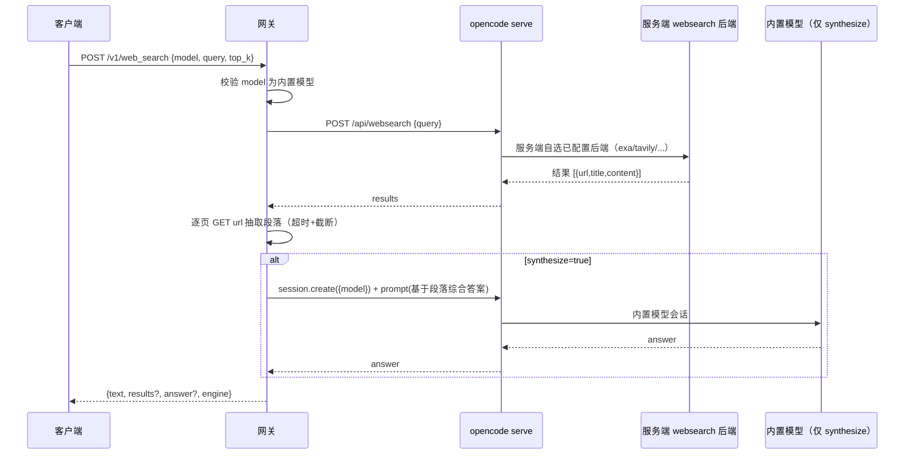

# API 设计文档（详细）

> 配套：[项目设计文档](./design.md)
> 参照项目：[TiaraBasori/OpenCode2API](https://github.com/TiaraBasori/OpenCode2API)
> 范围：实现截图中的全部 API（`/v1/models`、`/v1/chat/completions`、`/v1/responses`、`/v1/messages`），并补充**独立的 web-search API** 与**模型命名规则**。

---

## 1. 总览

| 方法 | 路径 | 协议族 | 说明 |
|:-----|:-----|:-------|:-----|
| `GET` | `/v1/models` | OpenAI | 模型列表（含虚拟模型 `auto` 与 Ollama 声明） |
| `POST` | `/v1/chat/completions` | OpenAI | Chat Completions（SSE 流式） |
| `POST` | `/v1/responses` | OpenAI | Responses API（SSE 流式） |
| `POST` | `/v1/messages` | Anthropic | Messages API（兼容 Claude SDK，SSE 流式） |
| `POST` | `/v1/web_search` | 自定义 | **独立 web-search API**（需指定内置模型） |
| `GET` | `/health` | 自定义 | 健康检查（含 OpenCode 后端连通性） |

> **设计原则**：三个推理端点聚焦**纯文本推理**。`web-search` 是**独立 API**，不内嵌为工具、不追求工具调用的通用性——它直接对外暴露 OpenCode 的内置 web-search 能力，并**必须指定一款内置模型**来驱动。

---

## 2. 公共约定

### 2.1 基础地址与鉴权

- **Base URL**：`http://<host>:<PORT>`（默认 `10000`）。
- **鉴权**（可开关，`API_KEY_ENABLED`）：
  - OpenAI 系端点：`Authorization: Bearer <API_KEY>`。
  - Anthropic `/v1/messages`：支持 `x-api-key: <API_KEY>`（或 `Authorization: Bearer`）。
  - 自定义 `/v1/web_search`：`Authorization: Bearer <API_KEY>`。
  - 未开启时无需携带；开启后缺失/错误返回 `401`。
- **Content-Type**：`application/json`。
- 注意：`OPENCODE_SERVER_PASSWORD` 保护的是**后端 `opencode serve`**，与对外 `API_KEY` 是两套独立凭据。

### 2.2 `model` 字段语义（三处统一）

| 取值 | 含义 |
|:-----|:-----|
| `"auto"` | 网关按 config/config.yaml `models.auto.regex` 从**内置模型池**随机选一款（见 design.md §4.3） |
| `<provider>/<model>` | 内置/提供商模型，直接透传给 OpenCode（如 `opencode/flint-40b-free`） |
| `"ollama/<id>"` | 本地 Ollama 自定义模型，需先在 `config/opencode.json` 声明（如 `ollama/qwen3:4b`） |

> 完整命名与解析规则见 **§7 模型命名规则**。

### 2.3 流式约定

- 请求 `stream: true` 时，响应为 **SSE**（`text/event-stream`），每行 `data: <json>`。
- OpenAI 系以 `data: [DONE]` 结束；Anthropic 系以 `message_stop` 事件结束。
- 非流式时返回单个 JSON 对象。

### 2.4 统一错误格式

```json
{ "error": { "message": "具体原因", "type": "invalid_request_error", "code": "model_not_found" } }
```

| HTTP | type | 常见 code | 含义 |
|:-----|:-----|:----------|:-----|
| 400 | `invalid_request_error` | `model_not_found` / `invalid_model` / `invalid_request` | 参数错误 |
| 401 | `authentication_error` | `invalid_api_key` | 鉴权失败 |
| 404 | `not_found_error` | `endpoint_not_found` | 路径不存在 |
| 429 | `rate_limit_error` | `quota_exceeded` | 限流/并发上限 |
| 500 | `api_error` | `upstream_error` | 网关内部错误 |
| 502 | `upstream_error` | `opencode_unavailable` | OpenCode 后端不可达 |
| 503 | `service_unavailable` | `no_available_model` | auto 池为空且无兜底 |

---

## 3. GET /v1/models

返回 OpenAI 兼容的模型列表。

### 请求
无 body；支持鉴权（若开启）。

### 响应（200）
```json
{
  "object": "list",
  "data": [
    { "id": "auto", "object": "model", "created": 1700000000, "owned_by": "gateway", "description": "内置模型正则随机" },
    { "id": "opencode/flint-40b-free", "object": "model", "created": 1700000000, "owned_by": "opencode" },
    { "id": "ollama/qwen3:4b", "object": "model", "created": 1700000000, "owned_by": "ollama" }
  ]
}
```

- `auto` 作为**虚拟模型**始终返回，供客户端选用随机内置模型。
- 其余条目来自 OpenCode 2.x `model.list()`（`ModelInfo[]`，含内置免费模型 `opencode/*-free` 与已配置 provider 的模型），并叠加 `config/opencode.json` 已声明的 Ollama 模型；`enabled=false` 与 `deprecated`/`alpha` 状态的模型不返回。
- 建议服务端缓存（TTL ~60s），避免每次请求打 OpenCode。

---

## 4. POST /v1/chat/completions

OpenAI Chat Completions 协议，完整 SSE 流式。**纯文本推理，不含 web_search 工具。**

### 请求体（关键字段）
```json
{
  "model": "auto",
  "messages": [
    { "role": "system", "content": "你是一个助手" },
    { "role": "user", "content": "用一句话介绍你自己" }
  ],
  "stream": true,
  "temperature": 0.7,
  "max_tokens": 2048,
  "reasoning_effort": "medium"
}
```

- `messages[].content` 以文本为主。
- `reasoning_effort` / `reasoning: {effort}` 透传给支持推理的模型（可选）。
- `temperature` / `top_p` / `max_tokens` 等采样参数：若 OpenCode/SDK 支持则透传，否则记录日志后忽略。

### 响应（非流式，200）
```json
{
  "id": "chatcmpl-xxx",
  "object": "chat.completion",
  "created": 1700000000,
  "model": "opencode/flint-40b-free",
  "choices": [
    { "index": 0, "message": { "role": "assistant", "content": "我是一个……" }, "finish_reason": "stop" }
  ],
  "usage": { "prompt_tokens": 123, "completion_tokens": 45, "total_tokens": 168 }
}
```

### 流式（`stream:true`）
按 OpenAI SSE 分块：`chat.completion.chunk`，含 `choices[].delta`（首次带 `role`），结束发 `data: [DONE]`。

### 与 OpenCode 的映射（2.x）
1. `resolveModel(model)` → 实际 OpenCode 模型（`{providerID, id}`，见 §7）。
2. `session.create({ model })` → 建会话并绑定模型；`messages` 折叠为**单段提示文本**（历史带 `[user]`/`[assistant]` 前缀，最后一条独立；`system` 角色经 `session.instructions.entry.put` 注入，见 design.md §4.2）。
3. `session.prompt({ text, files })` → **异步投递**，网关用 `session.wait()` 阻塞至会话空闲。
4. 流式：订阅 `/api/event` 的 `session.text.delta` 事件转成 OpenAI SSE 增量；结束后以最终助手消息全文对账补发（订阅窗口外丢失的开头/结尾一次性补齐）。
5. `usage` / `finish_reason` 取自最终助手消息的 `tokens` 与 `finish`（OpenCode 2.x 的 finish 枚举 stop/length/tool-calls/content-filter/error 已映射为 OpenAI 值）。

---

## 5. POST /v1/responses

OpenAI Responses API 协议。

### 请求体（关键字段）
```json
{
  "model": "auto",
  "input": "用一句话介绍你自己",
  "stream": true,
  "previous_response_id": "resp_xxx"
}
```

- `input`：字符串或输入项数组（`{role, content}` / `message` 等）。
- `previous_response_id`：会话续接，网关映射为 OpenCode `session.id`（带 TTL，见 design.md §4.2）；续接时网关用 `session.switchModel` 对齐本次请求的模型（2.x 模型绑定在会话上）。

### 响应事件（流式 SSE）
按 OpenAI Responses 事件序输出：
`response.created` → `response.in_progress` → `response.output_item.added` → `response.content_part.added` → `response.output_text.delta`（多次） → `response.output_text.done` → `response.output_item.done` → `response.completed`。

### 响应（非流式，200）
```json
{
  "id": "resp_xxx",
  "object": "response",
  "created_at": 1700000000,
  "model": "opencode/flint-40b-free",
  "output": [
    { "type": "message", "role": "assistant", "content": [ { "type": "output_text", "text": "我是一个……" } ] }
  ],
  "usage": { "input_tokens": 123, "output_tokens": 45 }
}
```

---

## 6. POST /v1/messages（Anthropic Messages API）

兼容 Claude SDK 的 Anthropic 协议。**纯文本推理，不含 web_search 工具。**

### 请求体
```json
{
  "model": "auto",
  "max_tokens": 1024,
  "system": "You are concise.",
  "messages": [ { "role": "user", "content": "用一句话介绍你自己" } ],
  "stream": true
}
```

### 响应（非流式，200）
```json
{
  "id": "msg_xxx",
  "type": "message",
  "role": "assistant",
  "model": "opencode/flint-40b-free",
  "content": [ { "type": "text", "text": "我是一个……" } ],
  "stop_reason": "end_turn",
  "usage": { "input_tokens": 123, "output_tokens": 45 }
}
```

### 流式（SSE）
按 Anthropic 事件序：`message_start` → `content_block_start` → `content_block_delta`（`text_delta`） → `content_block_stop` → `message_delta`（含 `stop_reason`） → `message_stop`。

> 说明：本端点聚焦文本对话。`web_search` 通过独立 API（§8）提供，不以 `tool_use` 形式内嵌；若后续需要客户端自定义函数工具，可作为独立扩展，不影响 web-search 的独立性。

---

## 7. 模型命名规则（内置 + 自定义 Ollama）

所有端点的 `model` 字段遵循统一命名与解析规则。

### 7.1 总形式

```
<namespace>/<model-id>        或  auto（虚拟模型）
```

- **保留字**：`auto`（虚拟）、`ollama/`（自定义本地命名空间）、`opencode/`（内置免费模型 `*-free` 系列，如 `opencode/flint-40b-free`）。
- 大小写不敏感；解析前统一 `toLowerCase()`（模型 ID 本身按 OpenCode 返回原样匹配）。

### 7.2 内置模型（Built-in）

| 项 | 规则 |
|:---|:-----|
| 标识形式 | `<provider>/<model-id>`，其中 `<provider>` + `<model-id>` 由 OpenCode 2.x `model.list()` 决定 |
| 首方（内置免费） | `opencode/<id>`，如 `opencode/flint-40b-free`、`opencode/glm-4.6-free`（免登录、cost=0） |
| 其他 provider | 沿用其 provider 前缀，如 `anthropic/...`、`openrouter/...` |
| 合法性 | 必须在 OpenCode 当前可用模型集中存在，否则 `400 model_not_found`；`enabled=false` 与 `deprecated`/`alpha` 模型视为不可用 |
| `auto` 池来源 | **仅内置模型**参与 config/config.yaml `models.auto.regex` 匹配（不含 Ollama 自定义，避免随机命中本地模型） |

### 7.3 自定义 Ollama 模型（Custom Ollama）

| 项 | 规则 |
|:---|:-----|
| 标识形式 | **必须**为 `ollama/<ollama-model-id>`，前缀 `ollama/` 为网关唯一自定义命名空间 |
| `<ollama-model-id>` | 必须与 `ollama list` 中的真实模型名**完全一致**（如 `qwen3:4b`、`llama3.1:8b`），允许 `:`、`.`、`-` |
| 声明要求 | 须在 `config/opencode.json`（`provider.ollama.models`）中声明（随镜像打包），未声明者视为未知模型 |
| 别名（可选） | config/config.yaml `ollama.aliases` 支持短名映射，如 `qwen→ollama/qwen3:4b`；别名在解析前先展开 |
| 校验 | 请求 `ollama/<id>` 不在 `config/opencode.json` 已声明模型中 → `400 model_not_found` |

### 7.4 解析优先级（`resolveModel`）

1. `auto` → 走 auto 池（§7.2），随机取一款内置模型。
2. 命中 config/config.yaml `ollama.aliases` → 展开为 `ollama/<id>`，继续第 4 步校验。
3. 命中内置别名表（可选）→ 展开为内置模型 ID。
4. 以 `ollama/` 开头 → Ollama 自定义（校验 §7.3）。
5. 含 `/<model-id>` → 内置/提供商模型透传（校验存在性）。
6. 裸名（无 `/`）→ 尝试内置别名表；未命中则 `400 model_not_found`。

### 7.5 校验正则（建议）

```regex
^(auto|[a-z0-9._-]+/[a-z0-9._:/-]+)$        # 大小写不敏感
```

- `auto` 单独匹配；
- `ollama/qwen3:4b`、`opencode/flint-40b-free` 均匹配；
- 拒绝空串、含空格、含 `/` 但段为空的非法形式。

---

## 8. POST /v1/web_search（独立 web-search API）

### 8.1 定位

- **独立 API**，不依赖 `tools` 机制，不与 Chat/Responses/Messages 的工具调用耦合。
- 检索主路径为 **OpenCode 2.x 服务端一等公民 websearch**（`websearch.query()`，服务端自选已配置后端，如 exa/tavily 等）；返回结果 URL 后由网关抓取原页抽取段落。
- **必须指定一款内置模型**（`model` 字段，见 §7.2）。2.x 下检索本身不消耗模型，该模型仅在 `synthesize=true` 时驱动答案综合；但仍要求为明确内置模型（禁止 `auto` 与 `ollama/`），保持契约稳定并为综合答案预留。

### 8.2 请求

```json
{
  "model": "opencode/flint-40b-free",
  "query": "OpenCode 项目 最近更新",
  "top_k": 5,
  "max_chars_per_page": 4000,
  "locale": "zh-CN",
  "recency": "month",
  "synthesize": false,
  "include_sources": true
}
```

| 字段 | 必填 | 默认 | 说明 |
|:-----|:-----|:-----|:-----|
| `model` | 是* | config/config.yaml `web_search.model` | **内置模型**（`<provider>/<id>`）；配置了默认值时可省略。仅 `synthesize=true` 时驱动模型 |
| `query` | 是 | — | 搜索关键词 |
| `top_k` | 否 | config/config.yaml `search.top_k`(5) | 结果条数（受服务端上限约束） |
| `max_chars_per_page` | 否 | config/config.yaml `search.max_chars_per_page`(4000) | 单页段落截断上限 |
| `locale` | 否 | `zh-CN` | 区域偏好（兜底 SearchProvider 用；服务端 websearch 不透传） |
| `recency` | 否 | — | 时间范围：`day`/`week`/`month`/`year`（当前两种路径均不透传，保留字段） |
| `synthesize` | 否 | `false` | 是否用该内置模型把段落综合成 `answer` |
| `include_sources` | 否 | `true` | 是否返回 `results[]` 明细 |

> *`model` 为内置模型；config/config.yaml `web_search.model` 有值时 `model` 可省略。传入 `auto` 或 `ollama/...` 返回 `400 invalid_model`。
> `top_k` / `max_chars_per_page` 未传时取 config/config.yaml 默认值，请求参数可覆盖。

### 8.3 响应（200）

```json
{
  "query": "OpenCode 项目 最近更新",
  "model": "opencode/flint-40b-free",
  "engine": "opencode-websearch",
  "answer": "（synthesize=true 时由内置模型生成，否则为 null）",
  "truncated": false,
  "results": [
    {
      "title": "OpenCode v2 发布说明",
      "url": "https://example.com/release",
      "snippet": "摘要……",
      "paragraphs": ["段落一……", "段落二……"]
    }
  ],
  "text": "段落一……\n\n段落二……\n\n（合并后的纯文本，可直接喂给模型）",
  "sources": [ "https://example.com/release" ]
}
```

- `engine`：实际使用的检索后端——服务端 websearch 成功时为 `opencode-websearch`，回退时为 config/config.yaml `search.provider`（如 `duckduckgo`）。
- `text`：核心产物——按 `top_k` 与请求 `max_chars_per_page`（默认取 config/config.yaml `search.max_chars_per_page`）截断后拼接的**段落文本**。
- `answer`：仅 `synthesize=true` 时由指定的内置模型基于段落生成；否则 `null`。
- `results[]`：仅 `include_sources=true` 返回。
- `truncated`：任一页超过单页上限被截断则为 `true`。

### 8.4 错误

| HTTP | code | 场景 |
|:-----|:-----|:-----|
| 400 | `invalid_request` | `query` 缺失/为空 |
| 400 | `invalid_model` | `model` 为 `auto`/`ollama/...`，或不在内置模型集 |
| 401 | `invalid_api_key` | 鉴权失败（若开启） |
| 502 | `upstream_error` | 搜索后端/抓取失败（整体失败；单页失败仅空段落） |

---

## 9. web-search 内部执行流程（独立 API）



- **主路径**：OpenCode 2.x 服务端 websearch（`websearch.query()`）返回 URL 与摘要，网关抓取原页抽取段落，返回 `text`（及可选 `answer`）。
- **兜底**：服务端 websearch 失败（未配置后端 / 503 等）时，网关回退到自实现的 `SearchProvider`（见 §9.1），保证 API 可用；`engine` 字段反映实际路径。
- 不引入工具调用协议：客户端只按 §8 的请求/响应格式使用。

### 9.1 自实现 SearchProvider（兜底）

```ts
interface SearchProvider {
  name: string;
  search(query: string, opts: { topK: number; locale?: string; recency?: string }):
    Promise<Array<{ title: string; url: string; snippet: string }>>;
}
```

- 可插拔后端（config/config.yaml `search.provider`，默认免费后端）：`duckduckgo`（默认，国内不稳）、`bing`、`brave`、`custom`（国内网关）。
- 抓取与抽取：对结果 URL 发 HTTP GET（超时 + UA），轻量正文抽取得到段落；单页失败返回空段落。
- 体积控制：默认取 config/config.yaml `search.max_chars_per_page`（4000），可被请求 `max_chars_per_page` 覆盖。

