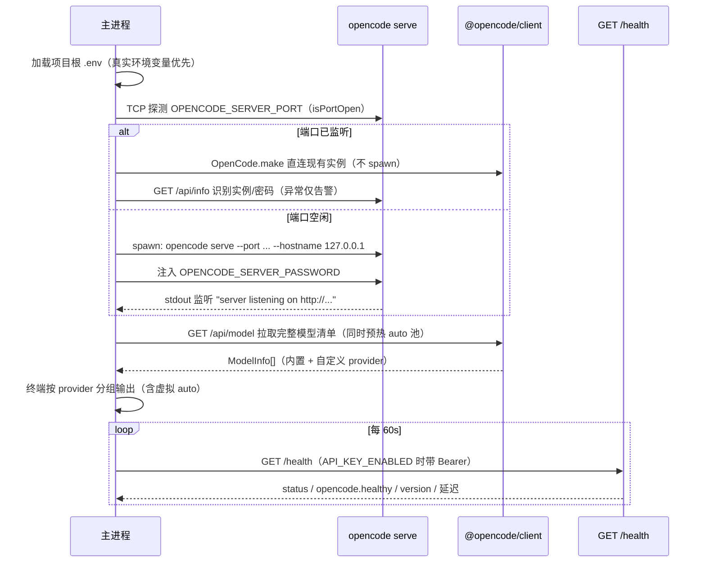
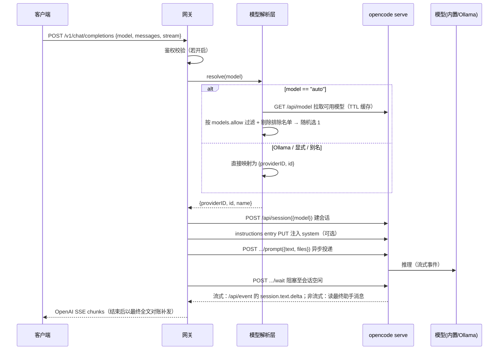

# OpenCode API Gateway —— 项目设计文档

> 工作标题：`opencode-api-gateway`（可重命名）
> 衍生自：[TiaraBasori/OpenCode2API](https://github.com/TiaraBasori/OpenCode2API)
> 状态：设计阶段（待评审）
> 相关文档：用法与端点示例 `README.md`｜接口契约（唯一事实源）`api.md`｜容器化部署与环境变量总表 `docker-deployment.md`｜协作与代码规范 `AGENTS.md`

---

## 1. 项目背景与目标

### 1.1 背景

[OpenCode](https://opencode.ai)（2.x 起仓库为 [anomalyco/opencode](https://github.com/anomalyco/opencode)）是一个本地运行的开源代码智能体（CLI）。它通过 `opencode serve` 启动一个无头 HTTP 服务，对外暴露 **OpenAPI 3.1** 端点（路由前缀 `/api/*`）；官方同时提供由该规范自动生成的 TypeScript 客户端（`@opencode/client`，与 CLI `@opencode/cli` 同版本耦合）。

OpenCode 内置了若干**免费模型**（`opencode/*-free` 系列，免登录、cost=0），也支持把 **Ollama / LM Studio / 任意 OpenAI 兼容服务** 作为本地 provider 接入。

原项目 [OpenCode2API](https://github.com/TiaraBasori/OpenCode2API) 已经验证了「把 OpenCode 运行时包装成 OpenAI 兼容 API 网关」这一路线的可行性：它启动 `opencode serve` 后端，再用 SDK 与后端通信，对上暴露 `/v1/chat/completions`、`/v1/responses`、`/v1/messages` 等端点。

### 1.2 目标与定位

本项目在 OpenCode2API 的基础上做**差异化改造**，目标是把 OpenCode 的内置能力收敛成一个**稳定、可配置、对国内环境友好**的推理 API 服务。核心能力：

1. **标准 API 使用免费模型推理**：兼容 OpenAI 的 Chat Completions / Responses API，可直接用内置免费模型推理。
2. **`auto` 模型模式**：通过配置指定模型名称**正则表达式**，在匹配到的模型列表里**随机**选一款进行推理，规避「免费模型名称不固定、部分模型国内不可用」的问题。
3. **Ollama 自定义模型接入**：可在配置中声明 Ollama 服务里的自定义模型，并经由本网关对外暴露。
4. **独立 web-search API**：输入关键词 → 返回匹配网页段落文字；`model` 可省略（自动默认链）或使用别名，不内嵌为工具。
5. **可选 API KEY 鉴权**：通过请求头 `Authorization: Bearer <key>` 做安全认证，可开关。

### 1.3 与原项目的功能差异（对照）

| 维度 | OpenCode2API（原） | 本项目（衍生） |
|:-----|:-------------------|:---------------|
| 模型选择 | 模型别名解析（如 `gpt5-nano → gpt-5-nano`）、allowlist | **新增 `auto` 白名单随机模式** + 国内可用性过滤 |
| 外部工具 | `web_fetch`（按 URL 抓取）、工具桥接 | **独立 `web-search` API**（关键词 → 段落文字，`model` 可省略/别名） |
| Ollama | 依赖 OpenCode 自身 provider 配置 | **显式配置项**声明 Ollama 自定义模型并对外暴露 |
| 鉴权 | `API_KEY` / 多用户 key | 同样支持，定位为**可选开关**；多 key 从 `config/.keys` 读取（一行一个），只做凭据分发与吊销，无配额/计费语义 |
| 端点 | chat/responses/messages + 面板/指标 | 聚焦 chat/responses，面板/指标作为可选扩展 |

---

## 2. 关键术语

| 术语 | 含义 |
|:-----|:-----|
| `opencode serve` | OpenCode 的无头 HTTP 服务，暴露 OpenAPI 端点（路由前缀 `/api/*`，默认端口 `4096`，host `127.0.0.1`） |
| OpenCode 客户端 | `@opencode/client`（2.x；scope 为 `@opencode`，不带 `-ai`），由服务端 OpenAPI 规范生成，**版本必须与 CLI `@opencode/cli` 同版本**（当前 `2.2.0`） |
| OpenCode 内置免费模型 | `opencode/*-free` 系列（如 `opencode/flint-40b-free`），免登录、cost=0，经 `model.list()` 返回 |
| Ollama provider | 通过 `@ai-sdk/openai-compatible` 适配器接入本地 Ollama，模型全称为 `ollama/<id>` |
| `auto` 模式 | 请求 `model: "auto"` 时，由网关按配置正则从可用模型池中**随机**选一款 |
| web-search 独立 API | 对外暴露检索能力：关键词 → 段落文字；检索主路径为服务端 websearch，`model` 可省略或使用别名（`synthesize` 时驱动综合） |

---

## 3. 总体架构

```mermaid
flowchart TB
    Client[客户端 / OpenAI SDK] -->|HTTP SSE| Gateway[API 网关层<br/>Fastify]
    Gateway --> Auth[鉴权中间件<br/>可选 Bearer]
    Gateway --> Resolver[模型解析层<br/>auto 正则 / Ollama / 显式]
    Gateway --> WebSearch[web-search 独立 API<br/>服务端 websearch 优先]
    Resolver --> SDK[客户端适配层<br/>@opencode/client]
    WebSearch --> Search[兜底搜索后端<br/>可插拔]
    Search --> Fetch[网页抓取 + 段落抽取]
    SDK -->|OpenCode.make| Server[opencode serve<br/>子进程 / 已有实例]
    Server --> Free[(OpenCode 内置免费模型<br/>opencode/*-free)]
    Server --> Ollama[(Ollama 本地模型)]
    Gateway --> Config[配置层<br/>env + config.yaml]

    subgraph 本进程
        Gateway
        Auth
        Resolver
        WebSearch
        SDK
        Config
    end

    subgraph 子进程/外部
        Server
        Free
        Ollama
        Search
        Fetch
    end
```

### 3.1 分层职责

1. **进程/服务层**：负责拉起并管理 `opencode serve` 子进程（亦可连接已存在的实例），提供健康检查、优雅退出。
2. **客户端适配层**：封装 `@opencode/client`（2.x），全部出站请求走注入的 `fetch`（带超时 + AbortSignal），向上提供归一化接口：`getServerInfo()`、`listModels()`、`createSession()`、`switchModel()`、`putInstruction()`、`prompt()`、`promptStream()`、`getMessages()`、`webSearch()`、`deleteSession()`。
3. **模型解析层**：把请求中的 `model` 字段翻译为 OpenCode 实际模型（`{providerID, id}`；auto 随机 / Ollama / 显式透传）。
4. **API 网关层**：对外暴露 OpenAI 兼容端点，处理鉴权、协议转换、SSE 流式回传。
5. **web-search 模块**：独立 API，服务端 websearch 优先（兜底可插拔搜索后端），对外返回段落文字。
6. **配置层**：集中管理端口、server 地址/密码、auto 正则、别名、搜索后端、API KEY 等。

---

## 4. 核心流程

### 4.1 启动流程（opencode serve 生命周期）



- 启动第一件事：加载项目根 `.env`（真实环境变量优先；容器内无 `.env` 属正常），再做配置校验。
- **端口优先探测**：用 TCP `connect` 判断 `OPENCODE_SERVER_PORT` 是否已监听。已监听则直接用 client 连接现有实例、**不 spawn**（生命周期也不归网关管理）；端口空闲才按配置端口与 `OPENCODE_SERVER_PASSWORD` 拉起子进程。
- `/api/info` 只用于识别实例与密码提示：200 视为 OpenCode；401 提示密码不一致；404/5xx 等异常响应告警但仍按配置直连，由 `/health` 暴露为 `degraded`。
- 端口通过环境变量配置（默认后端 `10001`，网关 `10000`）；后端 host 固定 `127.0.0.1`。
- 若 `OPENCODE_SERVER_URL` 已指向外部运行实例，则**不**拉起子进程，仅做客户端连接（便于复用已登录态 / 多实例）；启动时会探测一次，不可达仅告警。
- 鉴权：OpenCode server 端用 `OPENCODE_SERVER_PASSWORD`（用户名固定 `opencode`）做 HTTP Basic；客户端所有请求携带该凭据。
- **启动清单**：网关监听成功后拉取一次 `model.list()`，按 provider 分组把内置模型与自定义模型（Ollama 等）输出到终端，并附虚拟模型 `auto`；拉取失败只告警，不阻塞启动。
- **健康探测不属于网关进程**：网关内不跑周期定时器，只在 `/health` 被动应答。容器层由 `Dockerfile` 的 `HEALTHCHECK` 每 30s 以独立进程请求 `/health`（`scripts/docker-healthcheck.mjs`，见 §5.8 与 §6.1）；本机 `npm start` 调试时同一脚本可手动执行一次。

### 4.2 推理请求流程



### 4.3 `auto` 模型选择算法

1. 网关启动时（并周期性刷新，TTL 60s）调用 `model.list()`（`GET /api/model`），得到当前 OpenCode 可用的**内置模型**全集（`opencode/*-free` 免费模型及已连接 provider，过滤 `enabled=false` 与 `deprecated`/`alpha`；**不含 Ollama 自定义**，见 api.md §7.2）。
2. 对 config/config.yaml `models.allow` 的每条正则（可多条，大小写不敏感）匹配模型名；`models.allow` **同时是 `/v1/models` 的展示白名单**（空列表表示不过滤）。
3. 从命中结果中**剔除** config/config.yaml `models.auto.exclude`（国内不可用 / 已知不稳定）名单。
4. 若结果非空，`Math.random()` 随机取一款；若为空，回退到 `models.auto.fallback` 显式模型或返回 503。
5. 每次请求独立随机，避免热点模型被集中打满。

> 设计动机：免费模型名称随 OpenCode 版本/区域变动，且部分模型在国内网络不可用；白名单 + 排除名单 + 随机，可在「无需人工频繁改配置」的前提下保持服务可用，同时让对外模型清单稳定可控。

### 4.4 Ollama 自定义模型接入

- **配置位置**：本地推理写成 OpenCode 的自定义 provider——`config/opencode.json` 的 `providers.<id>`（2.x：`package: "@opencode/ai/providers/openai-compatible"` + `settings.baseURL` / `settings.apiKey`（`{env:...}` 插值）+ `models`），并 `plugins: ["-opencode.provider.ollama"]` 关掉内置 `ollama`；随镜像打包（烘的是模板，其 `models` **默认为空**——默认部署不预置任何模型，§6.5）；**不再通过环境变量**（`OLLAMA_BASE_URL` / `OLLAMA_MODELS` 移除）。
- **provider id 可配置**：`OLLAMA_LOCAL_PROVIDER`（默认 `ollama-local`）决定「哪些模型不进 `auto` 池」与 `web-search` 缺省取哪款本地模型；它必须与 `providers` 的键、`config.yaml` 的 `models.allow` 三处一致（§6.2、`docker-deployment.md` §3）。
- 模型全称对外暴露为 `<id>/<model>`（如 `ollama-local/qwen3.5:9b`）；网关经 `model.list()` 读取已声明的模型，用于校验与 `/v1/models` 展示。
- **命名规则**：默认路径是 `<providers键>/<模型id>`（如 `ollama-local/qwen3.5:9b`），须在 `providers.<键>.models` 声明并命中 `models.allow`；`ollama/<id>` 那条路径属于 OpenCode **内置** provider 保留名（被上面 `plugins` 关掉后，需自行在 `providers.ollama.models` 声明才有模型）。可选 `config/config.yaml` 的 `ollama.aliases` 短名映射（如 `qwen3.5→ollama-local/qwen3.5:9b`）。完整规则见 api.md §7.3。
- 客户端请求 `model: "ollama-local/<已声明的模型>"` 即可走本地推理，零成本、可离线。
- 注意：Ollama 工具调用需要足够 `num_ctx`，建议在 Ollama 侧适当调大（16k–32k）。

### 4.5 web-search 独立 API

目标：对外提供**独立的 web-search API**（不内嵌为工具、不追求工具调用通用性）。输入关键词，返回匹配网页的**段落文字**。

```mermaid
flowchart LR
    A[POST /v1/web-search<br/>model(可省略) + query] --> B[服务端 websearch<br/>websearch.query]
    B --> C[服务端已配置后端<br/>exa/tavily/...]
    C --> D[结果 URL + 摘要]
    D --> E[抓取原页 + 段落抽取 + 截断]
    E --> F[返回 text / results]
    E -.synthesize=true.-> G[内置模型综合 answer]
    B -.失败.-> H[兜底 SearchProvider<br/>duckduckgo/...]
    H --> E
```

- **服务端 websearch 优先**：优先调用 OpenCode 2.x 服务端一等公民 `websearch.query()`（服务端自选已配置后端）；失败（未配置后端 / 503 等）时回退到自实现可插拔 `SearchProvider`（`duckduckgo`/`bing`/`brave`/`custom`），响应 `engine` 字段反映实际路径。其中 `duckduckgo` / `bing` 免费且无需 key，`brave` 需 `SEARCH_API_KEY`，`custom` 为自建网关。
- **模型可省略且支持别名**：显式 `model` 按 api.md §7.4 解析（拒绝 `auto` / `ollama/<id>`）；省略时依次取 config/config.yaml `web_search.model`（若配置）→ 首个 `ollama-local/*` → `models.auto.fallback`，候选失效则跳到下一个，全部失效返回 503。2.x 下检索本身不消耗模型，该模型仅在 `synthesize=true` 时驱动答案综合。
- **抓取与抽取**：对结果 URL 发 HTTP GET，用轻量正文抽取得到段落；按 `top_k` 与请求 `max_chars_per_page`（默认取 config/config.yaml）截断，避免 token 爆炸。
- **错误处理**：单页失败不影响其余；超时/反爬返回空段落（或以摘要兜底）；整体失败才 502。
- 详细请求/响应见 [api.md §8](./api.md)。

### 4.6 鉴权

- 开关 `API_KEY_ENABLED`；开启时，所有 `/v1/*` 与 `/panel`（如启用）需携带 `Authorization: Bearer <key>`，否则 `401`。
- 鉴权挂在 **`onRequest`**，不是 `preHandler`：Fastify 在 preHandler 之前就做请求体校验，用 preHandler 的话未鉴权请求会先拿到 `400`，把 schema 细节白送给调用方（`tests/app.test.mjs` 有用例锁住这一点）。
- key 清单默认从 **`config/.keys` 读取，一行一个**（空行与 `#` 注释忽略、去重），路径由 `API_KEYS_FILE` 覆盖；环境变量 `API_KEY` 追加进同一集合并排在最前（`config.apiKeys`）。
- **文件内容是明文 key，读到就用**：不加解密、不哈希、不做 `{env:VAR}` 插值，也没有 key 与用户/权限的映射表；校验就是「任意一条与请求携带的值全等即放行」（用 `timingSafeEqual` 比较，长度不同直接判否）。
- 多 key 只用于分发凭据与吊销单条，**不含配额、计费与路由语义**；默认仍只用免费资源，多用户付费 key 不纳入。
- key 值只进内存与比较运算：不写日志、不进错误响应、不进镜像层（`config/.keys` 同时 gitignore 与 dockerignore；容器里读到的是挂载的宿主文件或镜像 `touch` 出来的**空文件**）。启动时按状态打一条日志（只含路径与条数）：有 key → `info`；**文件没找到且 `API_KEY` 也为空 → `error`**（鉴权开着却没人能进来，最容易被误判成网关故障）；文件没找到但 `API_KEY` 有值 → `warn`；鉴权关闭且无文件 → `debug`。
- `OPENCODE_SERVER_PASSWORD`（OpenCode 后端）与**本网关 API KEY 是两套独立凭据**：前者保护 OpenCode server，后者保护对外 API。

---

## 5. 模块设计

> 实现语言为**纯 JavaScript ESM**（`.mjs`，无 TypeScript / 无构建步骤），类型信息用 JSDoc 标注；相对 import 必须带 `.mjs` 扩展名。所有源码须通过 `npm run lint`（ESLint 10 flat config），规范正文见仓库根 `AGENTS.md`。

### 5.1 进程管理模块 `core/server-manager.mjs`
- `isPortOpen()` / `startServe()` / `stopServe()` / `isHealthy()`
- 启动时先做 TCP 端口探测：已监听则复用现有实例，空闲才 spawn；子进程 stdout 解析启动标志，退出自动重启（带退避）。
- 支持「外部实例模式」（不拉起子进程）。

### 5.2 客户端适配层 `core/opencode-client.mjs`
- 封装 `@opencode/client`（`OpenCode.make({ baseUrl, headers, fetch })`）；注入自定义 `fetch` 统一附加 Basic 凭据与超时控制。
- 暴露：`getServerInfo()` / `health()` / `listModels()` / `createSession({model})` / `switchModel()` / `putInstruction()` / `prompt({text, files, system})` / `promptStream({..., onDelta, signal})` / `getMessages()` / `webSearch()` / `listWebSearchProviders()` / `deleteSession()`。
- **推理生命周期**：`prompt` 为异步投递（2.x 语义），适配层内部用 `session.wait()` 阻塞至会话空闲，再按 `order:"asc"` 读取消息列表取**最后一条** assistant 消息归一化（`normalizeAssistant`：text / reasoning / tools / finish / tokens / cost / error）。
- **流式对账**：订阅 `/api/event` 的 `session.text.delta` 转发增量；`wait` 返回后以最终助手消息全文对账，补齐订阅窗口外丢失的开头/尾部。
- **错误归一**：助手消息内嵌 `SessionStructuredError`（如 `ProviderAuthError`）→ 统一 502 `upstream_error`。

### 5.3 模型解析层 `core/model-resolver.mjs`
- `resolve(requestedModel)` → `{ provider, modelId }`
- 维护 auto 池（带 TTL 缓存与刷新）、排除名单、fallback。
- 维护 Ollama 模型映射表。

### 5.4 API 网关层 `api/*`
- `routes/health.mjs`、`routes/models.mjs`、`routes/aliases.mjs`、`routes/chat.mjs`、`routes/responses.mjs`、`routes/messages.mjs`、`routes/web-search.mjs`
- `openapi.mjs`：注册 `@fastify/swagger` / `@fastify/swagger-ui`，`/docs` 提供 OpenAPI 3.1 交互文档、`/docs/json` 输出规范；请求体 schema 由路由内 zod schema 经 `toJsonSchema()` 生成，避免「文档 / 校验」两套定义漂移。
- 协议转换：OpenAI 请求体 → OpenCode `parts`；OpenCode 消息流 → OpenAI SSE（`chat.completion.chunk` / Responses 事件）。
- 会话映射：客户端 `session`/`conversation` 概念 ↔ OpenCode `session.id`，带 TTL 清理。

### 5.5 web-search 模块 `tools/web-search.mjs`
- `runWebSearch({ model, query, topK, ... })` → `{ text, results?, answer?, engine }`
- 优先**服务端 websearch**（`websearch.query()`，服务端自选已声明的后端；全新 OpenCode home 需先声明 provider，见 §6.5）；失败兜底走 `SearchProvider` 抽象，便于替换后端。

### 5.6 模型命名与解析 `core/model-resolver.mjs`
- 实现 api.md §7 的命名规则与解析优先级（`auto` / 内置 / `ollama/` / 别名）。
- 维护 config/config.yaml `ollama.aliases` 别名表、auto 池、排除名单、fallback。

### 5.7 配置层 `config.mjs`
- 使用 `zod` 校验环境变量 + `config/config.yaml`，集中暴露 `AppConfig`。
- `readApiKeys(path)` 读对外 key 清单（`API_KEYS_FILE`，默认 `config/.keys`）：一行一个、忽略空行与 `#` 注释、按出现顺序去重；文件缺失返回空数组（不报错），读不了则抛错让启动失败。`loadConfig` 把它与 `API_KEY` 合并成 `apiKeys`，`apiKey` 取第一个——健康探测脚本用它作为访问自身 `/health` 的 Bearer 凭据。
- `loadDotEnv()` 供进程入口在配置校验前加载项目根 `.env`（真实环境变量优先），不引入 dotenv 依赖。

### 5.8 启动清单与容器健康探测
- `startup-report.mjs`：把 `resolver.listAll()` 的结果整理成终端可读清单（内置 provider 在前，自定义 provider 分组，附虚拟 `auto`）；只做展示，不参与解析。
- `scripts/docker-healthcheck.mjs`：Docker `HEALTHCHECK` 的执行体，独立进程、不由网关调度。复用 `loadConfig()` 取监听端口与第一个 key（不重复实现 `.keys` 解析），带超时与 `AbortSignal` 请求网关自身 `/health`；**只有 HTTP 2xx 且响应体 `status="ok"` 才退出 0**——`/health` 在后端不可达时仍返回 200（`degraded`），只看状态码会把坏链路判成健康。判定行写 stdout：这个进程里没有网关的 pino logger，而 stdout 正是 `docker inspect` 保留的健康日志。

---

## 6. 配置体系

配置按**职责分层**：版本与**部署默认值**在 Dockerfile（镜像内 `ENV`，运行期可覆盖），真密钥走环境变量，业务默认走 `config/config.yaml`，provider 与服务端检索后端声明走 OpenCode 自身配置（`config/opencode.json`，镜像烘的是它的模板）。

### 6.1 Dockerfile（版本绑定 + 部署默认值）

- `@opencode/cli` 与 `@opencode/client` 版本在**构建期**固定（`ARG OPENCODE_CLI_VERSION` / `package.json` + lockfile），随镜像固化；两者**必须同版本**（当前 `2.2.0`）。**不再提供** `OPENCODE_CLI_VERSION` / `SDK_VERSION` 环境变量。
- `config/config.yaml`（直接入库）随镜像打包。**`config/opencode.json` 也随镜像打包**，但烘进去的是模板副本：`COPY config/opencode.json.example ./config/opencode.json`。原因是 opencode 2.2.0 **只读不写**这个文件（实测：全新镜像里没有，跑完 `opencode models` / `opencode serve` 也只创建状态库），不自带就没有任何自定义 provider；而真实 `config/opencode.json` 含本机地址、可能写明文密钥，由 `.dockerignore` 绝对排除，所以「烘模板 + 排除真文件」同时拿到一键部署与不进镜像层。挂载是**整目录替换**：`-v ./config:/app/config:ro` 后容器只看到宿主目录，目录里没放 `opencode.json` 连烘的那份一起消失（细节与单文件挂载写法见 `docker-deployment.md` §2.4）。
- provider 端点**可达与否不影响部署**（实测：`baseURL` 指向不可解析主机、`OLLAMA_API_KEY` 不设置，provider 照样注册、模型照样进 `/v1/models`）：清单来自声明，推理才真正打过去，失败表现为 `502`，`/health` 仍是 `ok`（它探的是容器内 `opencode serve`，不是 Ollama）。
- 镜像预设一组 OpenCode 精简变量：`OPENCODE_CONFIG_DIR=/app/config`、`OPENCODE_DISABLE_PROJECT_CONFIG`、`OPENCODE_DISABLE_CLAUDE_CODE`、`OPENCODE_DISABLE_CLAUDE_CODE_SKILLS`、`OPENCODE_DISABLE_AUTOUPDATE`、`OPENCODE_DISABLE_FILEWATCHER`（均为 `true`），减少每次请求固定注入的指令/技能/插件上下文。变量名逐个对 2.2.0 二进制核过；1.x 的 `OPENCODE_DISABLE_DEFAULT_PLUGINS` / `OPENCODE_DISABLE_LSP_DOWNLOAD` 在 2.x 已不被识别，故不再设置（留着只会给人「已经在裁剪」的错觉）。`OPENCODE_DISABLE_MODELS_FETCH` 同样存在，但它会影响内置模型目录，未验证不预设。
- 部署相关的**非敏感项**在镜像里就有默认值（`PORT=8000`、`OPENCODE_SERVER_PORT=10001`、`LOG_LEVEL=info`、`CONFIG_PATH=/app/config/config.yaml`、`API_KEY_ENABLED=false`、`API_KEYS_FILE=/app/config/.keys`、`OLLAMA_LOCAL_PROVIDER=ollama-local`），裸 `docker run` 也能起得来；每一项都是**默认值而非锁**，运行期 `-e` / `--env-file` 覆盖即可，不改镜像。与 `src/config.mjs` 不一致的地方只有端口（代码默认 `10000`，镜像 `8000`）与容器内路径，容器里以镜像为准。
- `OPENCODE_SERVER_PASSWORD` 在镜像里给了占位值 `88888888`：这条凭据保护的是**容器内 `127.0.0.1`** 的 serve 监听，不是对外端口，但它是写死在镜像层里的固定值，所以文档要求上线前 `-e` 改掉，且**禁止**在设置 `OPENCODE_SERVER_URL` 连远端实例时沿用。留空更糟：网关拉起的 serve 会拒绝客户端，模型清单直接失败（实测报 `Authentication required`）。
- `API_KEY_ENABLED` / `API_KEYS_FILE` 这两个**名字**含 `API_KEY` 的开关与路径会触发 BuildKit 的 `SecretsUsedInArgOrEnv` 告警。值是开关和路径、不是密钥，**告警属于预期**，不要为了消警告把它们挪回 `ARG` 或退回「只在代码里默认」。
- 镜像还预设 `OPENCODE_CONFIG_CONTENT={"websearch":{"provider":"random"}}`：给容器补上「跑过一次交互式 opencode」才会写进状态库的 websearch provider 声明（免凭据，见 §6.5）。运行期用 `-e` 覆盖即可，注意它是整体替换而非合并。它只管这类键，**声明 `providers` 无效**（实测），所以 provider 配置必须走文件（§6.5）。
- 真密钥项（`API_KEY` / `SEARCH_API_KEY`，以及 provider 的 `OLLAMA_API_KEY` / `TAVILY_API_KEY`）在镜像里**完全不存在**：既不写成 `ARG`，也不留 `ENV` 声明，真值一律由运行期注入（`-e NAME` / `--env-file`），因此不会进入镜像层与 `docker history`。`OLLAMA_API_KEY` 不给默认值还有个实际理由：镜像里那份 `{env:OLLAMA_API_KEY}` 缺值时插值成空串，provider 照样注册，只有端点真校验 key 才必须给。
- 对外 key 清单 `config/.keys`：`.gitignore` + `.dockerignore` 双重排除，镜像里只有一个 `RUN touch` 出来的**空文件**（`API_KEYS_FILE` 的镜像默认值就指它）。空文件与「文件不存在」的差别只在日志：前者是「没有 key」，鉴权开着时所有请求 `401`；`API_KEY` 环境变量仍然追加进集合并排最前，所以不挂卷也能用单条 key 开鉴权。
- **不要把宿主机的 `API_KEYS_FILE` 原样传进容器**：`.env` 与本机环境变量描述的是**宿主机**路径（Windows 下形如 `D:\...\config\.keys`），原样注入会指向一个不存在的文件，`readApiKeys` 只能返回空清单，于是开启鉴权后所有请求 `401`（启动日志的 `keysFile` + `keyCount` 就是用来定位这件事的）。要改容器内路径只能在 `docker run -e` 里写字面容器路径。
- **Docker `HEALTHCHECK` 由容器层负责健康状态**：`--interval=30s --timeout=10s --start-period=30s --retries=3`，`CMD ["node", "/app/scripts/docker-healthcheck.mjs"]`（`node:22-slim` 无 `curl`，所以用 node 脚本而不是 shell 探测）。脚本本身从镜像里的 `/app/scripts` 读取，凭据来自容器内的 `/app/config/.keys`（挂载时是宿主那份，没挂载时是镜像里 `touch` 出来的空文件）与 `API_KEY` 环境变量，**不出现在 `HEALTHCHECK` 命令行里**（`docker inspect` 会原样展示 `Cmd`，写进去等于把 key 公开）。副作用需知情：开启鉴权而 `.keys` 为空时脚本一律拿到 401 ⇒ 容器显示 unhealthy，这是「没人能通过鉴权」的正确表达。

### 6.2 环境变量（部署相关 / 敏感）

「代码默认」= `src/config.mjs` 的 zod 默认值（本机 `npm start` 用这套）；「镜像默认」= `Dockerfile` 的 `ENV`（容器里以它为准，运行期 `-e` 再覆盖）。**「不存在」是有意为之**：真密钥既不作 `ARG` 也不留 `ENV`，绝不进镜像层与 `docker history`。

| 变量 | 代码默认 | 镜像默认 | 说明 |
|:-----|:---------|:---------|:-----|
| `PORT` | `10000` | `8000` | 网关监听端口（容器内）。对外端口是 `-p 宿主:容器` 的左侧，与 `EXPOSE` 无关 |
| `OPENCODE_SERVER_PORT` | `10001` | `10001` | 后端端口（未设 `OPENCODE_SERVER_URL` 时生效） |
| `OPENCODE_SERVER_URL` | 空 | 空 | 外部实例地址；设置后不拉起子进程，直接连接 |
| `OPENCODE_SERVER_PASSWORD` | 空 | `88888888` | OpenCode server HTTP Basic 密码。镜像里那个是**占位**，只保护容器内 `127.0.0.1`，上线必须 `-e` 改掉（§6.1） |
| `API_KEY_ENABLED` | `false` | `false` | 是否开启对外 API KEY 鉴权 |
| `API_KEY` | 空 | **不存在** | 单个 key，追加进 `config/.keys` 的集合并排在最前 |
| `API_KEYS_FILE` | `./config/.keys` | `/app/config/.keys` | **对外 key 清单文件，一行一个**（空行/`#` 注释忽略、去重）。文件缺失只意味着「没有 key」，不报错；读不了（权限等）则启动失败。**别把宿主机路径传进容器**（§6.1） |
| `OLLAMA_LOCAL_PROVIDER` | `ollama-local` | `ollama-local` | 自定义本地 provider 的 id：决定哪些模型不进 `auto` 池、`web-search` 缺省取哪款本地模型。转小写、不能是保留名 `ollama`，且必须等于 `opencode.json` 里 `providers` 的键与 `models.allow` 里的写法（三处一致，`docker-deployment.md` §3） |
| `SEARCH_API_KEY` | 空 | **不存在** | 仅使用付费搜索后端时需要；默认免费后端无需 |
| `OLLAMA_API_KEY` | — | **不存在** | 网关不读，仅透传给 `opencode serve`：`config/opencode.json` 里 `{env:OLLAMA_API_KEY}` 插值用。不设置时插值成空串，provider 照样注册（实测） |
| `TAVILY_API_KEY` | — | **不存在** | 网关不读，仅透传给 `opencode serve`：固定某个检索后端时才需要（默认 `random` 免密钥） |
| `OPENCODE_CONFIG_CONTENT` | — | `{"websearch":{"provider":"random"}}` | 网关不读，透传给 `opencode serve` 的内联配置（整体替换镜像预设，见 §6.1；**不能**用来声明 provider） |
| `CONFIG_PATH` | `./config/config.yaml` | `/app/config/config.yaml` | 配置文件路径 |
| `LOG_LEVEL` | `info` | `info` | 网关日志级别（fatal/error/warn/info/debug/trace/silent） |

> 空串等于未设置：`-e OPENCODE_SERVER_URL=` 或 `--env-file` 留空都会落回默认值（`src/config.mjs` 的 `emptyToUndefined`），不会因「空字符串不合法」启动失败。

> 默认**尽量使用免费资源**：不配置付费模型 key、不使用付费搜索后端；`OPENCODE_API_KEYS`（多用户付费 key）仍不作为配置项。
> 对外 API KEY 的**多 key** 不属于「付费 key」：它是一份等值凭据清单（`config/.keys`，一行一个），只用于分发与吊销，见 §4.6。

### 6.3 config/config.yaml（业务默认值，直接入库、随镜像打包）

> 不含敏感信息，无 example 模板；密钥走环境变量（§6.2），唯一例外是同样不入库的对外凭据清单 `config/.keys`（§4.6）。

| 键 | 默认 | 说明 |
|:---|:-----|:-----|
| `models.allow` | `[]` | 模型白名单：全名命中任一正则才出现在 `/v1/models`，auto 也只从中选（空列表不过滤） |
| `models.auto.exclude` | `[]` | auto 选池的排除名单（国内不可用等） |
| `models.auto.fallback` | 空 | auto 池为空时兜底模型 |
| `models.aliases` | `{}` | 内置模型短名映射（可选） |
| `ollama.aliases` | `{}` | `短名 → ollama/<id>` 映射（可选） |
| `web_search.model` | 空 | 可选显式默认模型（支持别名）；留空自动取首个 `ollama-local/*`，无则 `models.auto.fallback` |
| `web_search.synthesize_default` | `false` | 默认是否综合答案 |
| `search.provider` | `duckduckgo` | 兜底搜索后端：`duckduckgo` / `bing` 免费无需 key；`brave` 需 key；`custom` 自建 |
| `search.base_url` | 空 | `custom` 后端地址（可选） |
| `search.headers` | `{}` | `custom` 后端请求头（可选） |
| `search.top_k` | `5` | 默认结果条数（API 可覆盖） |
| `search.max_chars_per_page` | `4000` | 默认单页截断（API 可覆盖） |
| `session.ttl_min` | `30` | 会话清理 TTL |

> `top_k` / `max_chars_per_page` 已**移除环境变量**，改为 `config/config.yaml` 默认值 + API 请求参数覆盖。

### 6.4 推理用量日志

每次推理成功（`chat` / `responses` / `messages` 的流式与非流式、`web-search` 的 `synthesize`）由 `src/core/usage.mjs` 记一条 `event=usage` 的结构化 info 日志：
`endpoint`、`model`、`stream`、`prompt_tokens`（`tokens.input + tokens.cache.read`）、`completion_tokens`、`reasoning_tokens`、`cache_read`、`cache_write`、`cost`、`duration_ms`。
不新增存储依赖；失败请求不记用量，走常规 error 日志。

### 6.5 config/opencode.json（provider 与检索后端；镜像烘模板）

> 模板 `config/opencode.json.example` 入库，且**构建期被复制成镜像里的 `/app/config/opencode.json`**（§6.1）——因为 opencode 2.2.0 只读不写这个文件，镜像不自带就没有任何自定义 provider，裸 `docker run` 就不算一次部署。
> 真实 `config/opencode.json` 含本机地址、可能写明文密钥，**不入库（gitignored）也不进镜像层（`.dockerignore`）**；文件里的密钥一律写成 `{env:...}`，进镜像的那份因此不含凭据。
> Docker 覆盖方式两种：`-v ./config:/app/config:ro`（**整目录替换**，宿主目录里没有 `opencode.json` 时连烘的默认值一起消失）或单文件挂载；改完 `docker restart` 生效。
> 本地直跑时网关 spawn 的 `opencode serve` 只自动发现项目根 / 全局的 `opencode.json`，需以 `OPENCODE_CONFIG=./config/opencode.json` 指向本文件——但**实测**：Windows 宿主的 CLI 没采纳 `OPENCODE_CONFIG` / `OPENCODE_CONFIG_DIR` 里的 provider 声明（同一份文件在容器里生效），本机排查时先确认读到的是不是全局那一份。

2.x 配置格式为 `providers.<id>.package/settings/models`（**不是** 1.x 的 `provider.<id>.npm/options`），完整字段见 `config/opencode.json.example`，不在文档重复维护。`providers` 的键必须等于 `OLLAMA_LOCAL_PROVIDER`（§6.2、`docker-deployment.md` §3）。

- 实际推理走 OpenCode 的 `providers` 声明（默认 id `ollama-local`）；网关经 `model.list()` 读取已声明模型做校验与 `/v1/models` 展示。**声明即列出**：端点不可达、`OLLAMA_API_KEY` 未给都不影响清单，只有推理才真的打过去（§6.1）。
- `OLLAMA_BASE_URL` / `OLLAMA_MODELS` 环境变量**移除**，统一由该文件管理。
- **服务端 websearch 主路径靠「provider 声明」，不靠密钥**：2.x 未声明 provider 时 `websearch.query()` 直接返回 `Web search provider is required`。宿主机跑过交互式 opencode，声明会持久化在它自己的状态库（`~/.local/share/opencode/opencode.db` 的 `kv` 表：`websearch:provider = "random"`）；容器是全新 OpenCode home，没有这条记录，所以要在配置里声明。实测：容器内仅声明 `{"websearch":{"provider":"random"}}`、不配任何凭据，即可拿到 `engine=opencode-websearch`（服务端自选后端）；要固定 tavily/exa 等才需要额外提供对应 `*_API_KEY`。
  声明方式两种：`config/opencode.json` 的 `websearch.provider`，或环境变量 `OPENCODE_CONFIG_CONTENT`（镜像已预设前者所需的 `random`，见 §6.1）。与 `OPENCODE_DISABLE_*` 精简变量无关——实测取消全部精简变量仍报错，补上声明立刻可用。

---

## 7. API 端点设计

> 完整字段、请求/响应示例、SSE 事件序、错误码与 web-search 设计见 **[docs/api.md](./api.md)**。

| 方法 | 路径 | 协议族 | 说明 |
|:-----|:-----|:-------|:-----|
| `GET` | `/health` | 自定义 | 健康检查（含后端连通性） |
| `GET` | `/v1/models` | OpenAI | 模型列表（含虚拟模型 `auto` 与 Ollama 声明） |
| `GET` | `/v1/aliases` | 自定义 | 模型别名列表（`models.aliases` / `ollama.aliases` 的配置声明） |
| `POST` | `/v1/chat/completions` | OpenAI | Chat Completions（SSE 流式） |
| `POST` | `/v1/responses` | OpenAI | Responses API（SSE 流式） |
| `POST` | `/v1/messages` | Anthropic | Messages API（兼容 Claude SDK，SSE 流式） |
| `POST` | `/v1/web-search` | 自定义 | **独立 web-search API**（`model` 可省略/别名） |
| `GET` | `/docs` | 文档 | Swagger UI（交互式文档，实现辅助） |
| `GET` | `/docs/json` | 文档 | OpenAPI 3.1 JSON（由路由 schema 生成） |

- 推理三端点（`chat` / `responses` / `messages`）均支持 `model: "auto"`、`<provider>/<id>` 内置模型、以及 `ollama/<id>`。
- **`web-search` 是独立 API**，不内嵌为工具；仅 `query` 必填，`model` 可省略（`web_search.model` → 首个 `ollama-local/*` → `models.auto.fallback`）或使用别名；显式指定时拒绝 `auto` / `ollama/<id>`。
- 模型命名与解析规则见 [api.md §7](./api.md)；端点细节见 [api.md §8](./api.md)。
- 错误统一格式：`{ "error": { "message", "type", "code" } }`，常见 `401/400/502/503` 见 api.md §2.4。

请求示例（节选，详见 api.md）：

```bash
# auto 模式 + 鉴权
curl -X POST http://127.0.0.1:10000/v1/chat/completions \
  -H "Authorization: Bearer $API_KEY" \
  -H "Content-Type: application/json" \
  -d '{"model":"auto","messages":[{"role":"user","content":"你好"}],"stream":true}'
```

---

## 8. 关键技术决策与风险

| 风险 / 决策点 | 说明与对策 |
|:-------------|:-----------|
| **客户端与 serve 版本耦合** | `@opencode/client` 由 server OpenAPI 生成，必须在 Dockerfile 锁定 `@opencode/cli` 与 `@opencode/client` 同版本；跨版本字段直接对不上，不做多版本兼容。 |
| **免费模型不固定 & 国内不可用** | 这是 `auto` 模式的立项动机；用正则 + 排除名单 + 随机 + TTL 缓存缓解。 |
| **web-search 国内可用性** | 服务端 websearch 优先；兜底 provider 中 `duckduckgo` / `bing` 免费免 key（`duckduckgo` 国内不稳），`brave` 需 key，`custom` 可接国内网关。 |
| **web-search 模型默认值** | `model` 可省略：`web_search.model` → 首个 `ollama-local/*` → `models.auto.fallback`，避免默认绑定某款易下线模型；显式仍拒绝 `auto` / `ollama/<id>`。 |
| **流式保真** | 2.x 以 `/api/event` SSE 事件流驱动；`session.text.delta` 转发增量，`wait` 后以最终助手消息全文对账补发（订阅窗口外丢失一次性补齐）。 |
| **消息列表排序陷阱** | 2.x `message.list` 默认**新→旧**；适配层固定 `order:"asc"`（旧→新）后取末条 assistant，否则续接会话会取到旧轮结果。 |
| **会话生命周期与并发** | OpenCode session 需按时清理；网关用 TTL 映射表（`session.ttl_min`）+ 用完即删（无续接语义的端点），避免后端堆积。 |
| **内置免费模型鉴权** | 2.x `opencode/*-free` 模型免登录、cost=0，无需 `/connect`；仅 Ollama 等自定义 provider 需在 `config/opencode.json` 配置。 |
| **工具结果体积** | web-search 段落需截断（config/config.yaml `search.max_chars_per_page`，请求 `max_chars_per_page` 可覆盖），防止上下文溢出。 |

---

## 9. 实施里程碑（建议）

1. **M1 骨架**：进程管理 + 客户端适配层 + `/health` + `/v1/models`，跑通「显式模型推理」。
2. **M2 协议**：完整 Chat Completions / Responses 的 SSE 流式转换。
3. **M3 auto 模式**：正则池 + 排除 + 随机 + TTL 缓存。
4. **M4 Ollama**：配置化声明与映射。
5. **M5 web-search 独立 API**：内置模型驱动 + 兜底 SearchProvider + 段落抽取。
6. **M6 鉴权与运维**：API KEY、多用户 key、Docker、面板/指标（可选）。

---

## 10. 参考资源

- OpenCode 仓库（2.x）：https://github.com/anomalyco/opencode
- OpenCode 官方文档（Server / SDK）：https://opencode.ai/docs/server 、https://opencode.ai/docs/sdk
- OpenCode 中文文档：https://open-code.ai/zh/docs/sdk
- Ollama provider 配置：https://opencode.ai/docs/providers
- 原项目（衍生来源）：https://github.com/TiaraBasori/OpenCode2API
- OpenAI API 规范（Chat Completions / Responses）：https://platform.openai.com/docs/api-reference
